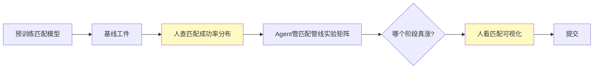
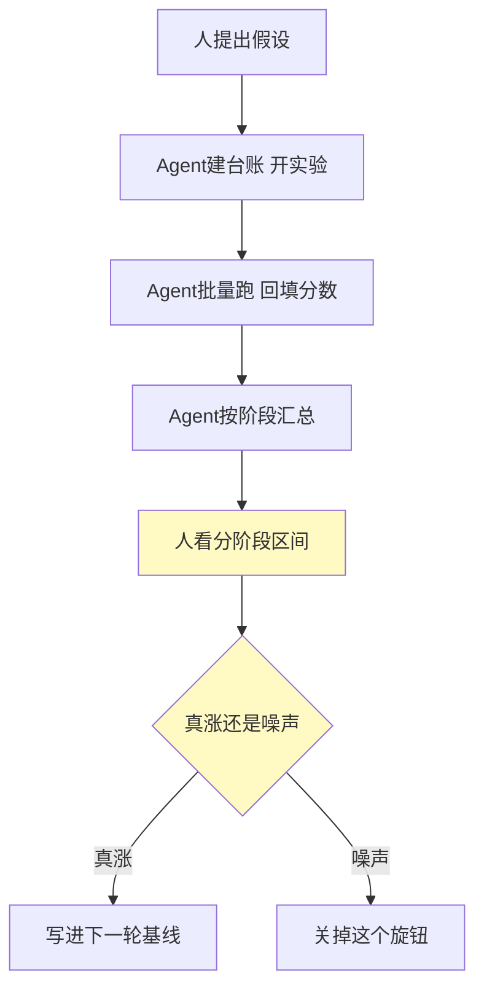

# 第15章 图像比赛详解：Image Matching Challenge 2025（2025，几何视觉中的 Agent 实验管理）

> **本章目标**：看一个“数值指标看不出问题、人眼一看就知道”的比赛。Image Matching 是几何视觉任务——判断两张图是不是拍同一个地方、匹配点对不对。这类错误在指标上常常不明显，但在可视化里一目了然。所以这一章的核心技能是：**亲自看匹配可视化，而不是只看 Agent 汇总的分数。** 顺便还要学一件事：**当实验有几十上百次时，怎么让 Agent 替你管账，而由你来做归因。**

---

## 开篇：为什么几何视觉必须“用眼睛看”

前面几章的图像任务（分类、回归），指标和“看得对不对”基本能对上。但 Image Matching 不一样。

它的任务是：给你两张图，找出“这两张图里哪些点是同一个物理点”。比如同一栋楼从两个角度拍，你要把“楼顶那个角”在两张图里都标出来。这类匹配错误，在数值指标（比如匹配成功率）上可能只差几个百分点，但人把匹配线画出来一看——大量连线是歪的、连到了完全无关的地方。

为什么指标看不出来？因为指标是“平均”的。100 对匹配里错 5 对，成功率 95%，看着不错。但那 5 对如果恰好是关键区域，实际可用性可能很差。**平均值掩盖了“错在哪”。**

再往深一层说，这个比赛的评分是 mAA（mean Average Accuracy，平均准确率），它要在多个场景、多个难度档位上取平均。而场景之间的差异极大：有的地方纹理丰富，随便匹配都对；有的地方是一整面白墙，神仙来了也只能瞎猜。**平均分把“简单场景送的分”和“难场景丢的分”搅在一起，你根本不知道自己在哪儿强、哪儿弱。**

所以这一章反复讲一件事：**几何视觉的验证，必须人眼介入。**



---

## 15.1 比赛与数据

图像匹配任务，评估特征匹配和几何验证的准确性，2025 年 Kaggle 竞赛，2025 年 6 月 3 日结束。

任务：给定多张图（同一场景的不同视角），找出跨图的对应点。评估通常看“匹配精度”（匹配点对得准不准）和“覆盖率”（找到多少对），最后汇总成 mAA。

数据特点：

- 视角变化大、光照变化、重复纹理（比如一排窗户，容易认错）；
- 错误往往集中在“重复纹理”和“弱纹理”区域；
- 数值指标对“错在哪”不敏感；
- 同一个场景里，图片数量差异很大，有的几十张，有的上百张。

最后这条是本章后半段的关键。图片一多，**“哪两张图该配成一对”本身就成了一个问题**——你不可能把 100 张图两两全试一遍（那是 4,950 对），时间根本不够。所以真实的方案里，第一步几乎都不是匹配，而是**选图对**。

---

## 15.2 自动基线工件

预训练匹配模型（如 SuperPoint / LightGlue 类方法）的基线工件；人检查匹配成功率在不同场景下的分布。

先解释两个词：

- **特征提取**：找出图里“有辨识度”的点（角点、纹理丰富处），给每个点一个描述向量。你可以理解成给每个点拍一张“证件照”，这张证件照要能区分它和别人；
- **匹配 + 几何验证**：把两张图的特征点配对，再用 RANSAC（随机抽样一致，一种鲁棒拟合方法）验证哪些配对满足几何约束（比如单应矩阵）。

**单应矩阵**（homography）这个词得单独说一下。它是个 3×3 的矩阵，作用是“把一张图里的点，映射到另一张图里的位置”。如果两张图拍的是同一个平面（比如都拍一面墙），那这个映射是精确的；如果场景是立体的，它只是近似。**RANSAC 干的事，说白了就是“反复随机抽几对点，算一个矩阵，看谁跟这个矩阵合得来，合得来的算内点，合不来的算外点”。**

```python
# src/baselines/matching_baseline.py
"""
图像匹配基线：SuperPoint 特征 + LightGlue 匹配（示意）。
产出匹配工件：每对图的匹配点数、成功率。
"""
import numpy as np


def match_pair(feat_a, feat_b, matcher):
    """
    对一对图做特征匹配 + 几何验证。
    返回：匹配点数、内点数（RANSAC 认为正确的点数）。
    """
    m = matcher(feat_a, feat_b)          # 初步匹配：按证件照相似度配对
    inliers = ransac_verify(m)           # 几何验证：筛掉"看着像、其实不合规"的
    return len(m), len(inliers)


def ransac_verify(matches):
    """RANSAC 几何验证（示意）：拟合单应矩阵，保留内点。"""
    # 实际用 cv2.findHomography 的 RANSAC 模式
    return matches[: int(len(matches) * 0.8)]   # 占位：保留 80%
```

人检查：匹配成功率在不同场景下（强光、弱光、重复纹理）差多少？哪类场景是重灾区？

真实赛场上的基线长什么样？公开的第 14 名方案写得很具体：先用 DINOv2 提全局特征，用 t-SNE 降维，再用 HDBSCAN 聚类把图分成几组；为了稳，他们还定义了一个置信度 s，是“聚类置信度”和“轮廓系数”的调和平均，**只有 s 大于 0.6 才接受这个分组**。分组之后，用 ALIKED 提关键点、LightGlue 做匹配，整图跑 1280 和 1088 两种分辨率，裁剪区域跑 1280；裁剪位置由 DBSCAN 找“匹配点最密的地方”决定；每张图最多 8,192 个关键点，把总运行时间压到 6 小时左右；最后用 PyCOLMAP 3.11.1 做增量式三维重建。

这段话信息量很大，我们挑三个点说：

1. **先聚类再匹配**，不是为了好看，是为了“别把不同场景的图硬配到一起”；
2. **8,192 个关键点**这个上限，是算出来的，不是拍的——再多就跑不完了；
3. **6 小时**这个数字，说明这个比赛从第一天起就是“时间预算”的比赛。

---

## 15.3 Agent 管理匹配管线的实验矩阵

图像匹配管线包含多个阶段：特征提取、匹配、几何验证、RANSAC。Agent 可以批量管理不同组合的实验工件；人判断**哪个阶段的改动带来了真实增益**，而不是被整体分数的波动误导。

```python
# src/experiments/match_matrix.py
"""
匹配管线实验矩阵：特征器 × 匹配器 × RANSAC 阈值。
Agent 跑，人判断哪个阶段真涨。
"""
MATCH_MATRIX = [
    {"feature": "superpoint", "matcher": "lightglue", "ransac_thr": 1.0},
    {"feature": "superpoint", "matcher": "lightglue", "ransac_thr": 2.0},
    {"feature": "disk",       "matcher": "lightglue", "ransac_thr": 1.0},
]
```

**人判断“哪个阶段真涨”**：整体分数从 0.70 涨到 0.72，是特征器换了的功劳，还是 RANSAC 阈值调了的功劳？这要分阶段看工件，不能只看总分。**Agent 汇总的是总分，归因得靠人拆。**

那 Agent 到底怎么管几十上百次实验？靠一本账。这本账要记的不是“哪个分数高”，而是“**每次只动了哪一个变量**”。我们让它建一个实验台账：

```python
# src/experiments/ledger.py
"""
实验台账：一行一次实验，记录"只改了什么"和"结果如何"。
没有这本账，二十次实验跑完你只会得到一个"最好的分数"，
而不知道它是怎么来的——下次想复现，抓瞎。
"""
import json
from pathlib import Path


def new_run(exp_id, base_config, change_desc, stage):
    """开一条新记录。change_desc 必须写清楚"这次只动了什么"。"""
    return {
        "exp_id": exp_id,
        "base_config": base_config,   # 基线配置，用来做减法
        "change_desc": change_desc,   # 人写的改动说明，比如"只把 ransac_thr 从 1.0 调到 2.0"
        "stage": stage,               # 改的是哪个阶段：feature / match / ransac / refine
        "score": None,                # 分数，跑完回填
        "score_std": None,            # 多次运行的标准差，用来判断"涨了"是不是真的
        "cost_minutes": None,         # 花了多少分钟，时间也是成本
        "verdict": None,              # 人的裁决：真涨 / 噪声 / 回退
    }


def save_ledger(runs, path="artifacts/experiments/ledger.json"):
    """落盘。JSON 是纯文本，人也能直接打开看。"""
    Path(path).parent.mkdir(parents=True, exist_ok=True)
    Path(path).write_text(json.dumps(runs, ensure_ascii=False, indent=2),
                          encoding="utf-8")
    print(f"✅ 台账已保存：{path}（共 {len(runs)} 条）")
```

这本账的妙处在于 `stage` 这一列。有了它，你随时可以问一句：“**所有动了 ransac 阈值的实验，分数变化是多少？**”如果答案是“在噪声范围内晃”，那你就知道这个旋钮不值得再拧了。

真实比赛里，这个判断被反复验证过。有公开复盘提到，很多队伍尝试过调 COLMAP 的参数、按“注册图像数”排序来挑重建结果，**对榜单的效果很有限**。原因也不难理解：容易分开的场景，本来就不会出现跨场景的误注册；难分开的场景，重建本身就崩了，按数量排序也救不回来。你看，这就是“分阶段归因”的价值——**它让你少走十几天弯路。**

Agent 跑完一轮，我们可以让它交作业：

```
把 artifacts/experiments/ 下这周的实验结果汇总成一张表：
1. 按 stage 分组，列出每组的改动、分数、标准差、耗时
2. 标出"分数变化小于两倍标准差"的实验，这些算噪声
3. 不要下结论说哪个方案最好，只把数据摆出来
我要自己看哪个阶段真涨。
```

模型会这样回应：

```
> （思考过程）用户明确说"不要下结论"，那我就只整理数据。
> 噪声判断用 2 倍标准差是常规做法，但要说明这只是经验阈值。
> 按 stage 分组，方便人做归因。

已完成，汇总表在 artifacts/experiments/weekly_summary.md：

【按阶段分组】
  stage=feature  改动 6 次  分数区间 0.698~0.724  平均耗时 41 分钟
  stage=match    改动 4 次  分数区间 0.701~0.706  平均耗时 41 分钟
  stage=ransac   改动 5 次  分数区间 0.699~0.703  平均耗时 41 分钟
  stage=refine   改动 3 次  分数区间 0.702~0.709  平均耗时 58 分钟

【落在噪声内的实验（变化 < 2 倍标准差）】
  exp_014  exp_015  exp_019  exp_022  exp_027

【数据上的观察】
  只有 feature 组的分数区间明显更宽，其他三组的区间
  都压在 0.005 以内。但样本量小，这只是描述，不是结论。

【耗时提醒】
  refine 组平均多花 17 分钟，分数区间却没拉开。

没有替你选方案，等你定。
```

这张表最漂亮的地方是最后一行：“**没有替你选方案，等你定。**”Agent 把数据整理得干干净净，然后把笔递给你。**这就是实验管理该有的样子：它管账，你拍板。**



---

## 15.4 提交前的可视化审查（人的不可替代性）

图像匹配的错误往往在数值指标上不明显，但在可视化中一目了然。人必须**亲自查看匹配可视化工件**，而不是仅依赖 Agent 汇总的分数。

```python
# src/eda/match_visualize.py
"""
匹配可视化：把两张图的匹配点连线画出来。
Agent 生成，人看。错得离谱的连线，人一眼就能发现。
"""
import matplotlib.pyplot as plt


def draw_matches(img_a, img_b, pts_a, pts_b, out_path, max_show=50):
    """把两图并排，画匹配连线。"""
    fig, ax = plt.subplots(1, 2, figsize=(12, 6))
    ax[0].imshow(img_a); ax[0].axis("off"); ax[0].set_title("Image A")
    ax[1].imshow(img_b); ax[1].axis("off"); ax[1].set_title("Image B")
    # 画前 max_show 条连线（示意，实际用不同颜色区分内点/外点）
    for i in range(min(max_show, len(pts_a))):
        fig.add_artist(plt.Line2D(
            [pts_a[i][0], pts_b[i][0] + img_a.shape[1]],   # 右图整体右移一个图宽
            [pts_a[i][1], pts_b[i][1]],
            color="lime" if i % 2 else "red", linewidth=0.8))
    fig.savefig(out_path, dpi=120, bbox_inches="tight")
    plt.close(fig)
    print(f"✅ 匹配可视化已生成：{out_path}")
```

人看可视化时，重点找：

- **大量连线交叉乱穿**：匹配彻底错了；
- **连线集中在某个角落**：模型只抓到了局部；
- **重复纹理区连线错位**：一排窗户里，连到了隔壁窗户。

> **人的视觉审查，是 Agent 汇总指标无法替代的判断环节。** 指标告诉你“平均不错”，可视化告诉你“错在哪、错得多离谱”。

那怎么让 Agent 把可视化准备好，交给你的眼睛来审？这样问：

```
请从 artifacts/ 里挑 20 对测试图，用当前匹配模型跑一遍，
把匹配点连线画出来存到 artifacts/viz/，
其中挑 5 张"内点比例最低"的（最可疑的）单独放大。
先别改模型，我要看图再决定改哪个阶段。
```

模型会这样回应：

```
> （思考过程）用户要可视化，不要修复。我按内点比例排序取
> 最可疑的 5 对，并生成连线图。要提醒：连线图里红色是外点、
> 绿色是内点，方便人一眼看出错误集中在哪。

已完成：
  artifacts/viz/random_20/        20 张连线图
  artifacts/viz/worst_5/           5 张最可疑的放大版

【最可疑的 5 对，按内点比例升序】
  pair_0137  内点率 0.41   ← 连线大面积交叉
  pair_0288  内点率 0.47
  pair_0091  内点率 0.52
  pair_0342  内点率 0.58
  pair_0155  内点率 0.61

【内点率与场景的关联】（我统计了一下）
  含重复纹理（窗格/栅栏）的场景：平均内点率 0.52
  其他场景：平均内点率 0.83

【我的观察】
  错误集中在重复纹理区域，可能是特征器在重复结构上
  产生了大量似是而非的匹配。建议你重点看 pair_0137，
  如果确认是重复纹理问题，可以试试提高特征描述子的
  区分度，或在 RANSAC 前加一个"唯一性"筛选。

没有改动任何模型或配置。
```

它把“最可疑的样本”直接挑出来放到一个文件夹里，等你用眼睛过一遍。**这才是 Agent 在视觉任务里最正确的用法：它负责把可疑样本挑出来，你负责用眼睛定性。**

顺便说一句，这种“挑最差样本给人看”的做法，在真实比赛里是有回报的。有队伍复盘说，他们最后阶段最大的提升，不是换了哪个模型，而是**把“旋转估计”的结果也加进集成**——之前为了省时间，把这个中间结果直接丢了，后来捡回来，涨了大约 3.5 个百分点。这个 3.5 分不是算出来的，是有人把中间产物画出来看了一眼，才想起来“这东西好像有用”。

---

## 15.5 提交

```python
# 提交文件生成 + 匹配可视化检查清单
from src.submit.make_submission import make_submission
make_submission("artifacts/test_preds/test_preds_MATCH_v001.npy",
                "data/sample_submission.csv",
                "artifacts/submissions/submission_MATCH_v001.csv")
# 检查清单：
# [ ] 随机抽 20 对，画可视化，人眼看一遍
# [ ] 重复纹理场景的匹配是否明显错位
# [ ] 成功率分布是否有异常双峰
```

“异常双峰”这个词解释一下：把成功率画成直方图，如果它鼓出两个包，说明你的数据里混着两类完全不同的场景，一类好匹配、一类没法匹配。**这时候用一个平均分汇报，等于用一个人的身高加上一个人的体重，得出一个“平均 1 米 4”的怪东西。**

---

## 15.6 小结

**在几何视觉任务中，人的视觉审查仍然是 Agent 汇总指标无法替代的判断环节。**

- 匹配管线多阶段，Agent 管矩阵和台账，人做归因（哪个阶段真涨）；
- 数值指标对“错在哪”不敏感，可视化才看得出；
- 提交前必须人眼抽查匹配可视化；
- 实验多了不可怕，可怕的是没有台账——记“只改了什么”，比记“得了多少分”重要。

这一章给所有“视觉输出”类任务一个通用提醒：**凡是人能一眼看出对错的场景，就别只信数字。** 分类、检测、匹配，指标是参考，眼睛是终审。

再往大一点说，这一章其实在讲两种“管理”的分工：**Agent 擅长的是“不漏”——几十上百次实验，它一次都不会忘；人擅长的是“值不值”——这次涨的 0.003，是真的，还是噪声？** 前者靠记性，后者靠判断。两种能力都不便宜，但只有第二种能决定你该往哪儿走。

> **下一章预告**：第四部分（图像）结束，第五部分进入文本数据。第 16 章建立文本 Vibe 工作流——那是 LLM 的主场，Agent 既能执行，又能当“模型”本身，角色更复杂。