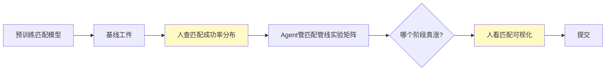

# 第15章 图像比赛详解：Image Matching Challenge 2025（2025，几何视觉中的 Agent 实验管理）

> **本章目标**：看一个“数值指标看不出问题、人眼一看就知道”的比赛。Image Matching 是几何视觉任务——判断两张图是不是拍同一个地方、匹配点对不对。这类错误在指标上常常不明显，但在可视化里一目了然。所以这一章的核心技能是：**亲自看匹配可视化，而不是只看 Agent 汇总的分数。**

---

## 开篇：为什么几何视觉必须“用眼睛看”

前面几章的图像任务（分类、回归），指标和“看得对不对”基本能对上。但 Image Matching 不一样。

它的任务是：给你两张图，找出“这两张图里哪些点是同一个物理点”。比如同一栋楼从两个角度拍，你要把“楼顶那个角”在两张图里都标出来。这类匹配错误，在数值指标（比如匹配成功率）上可能只差几个百分点，但人把匹配线画出来一看——大量连线是歪的、连到了完全无关的地方。

为什么指标看不出来？因为指标是“平均”的。100 对匹配里错 5 对，成功率 95%，看着不错。但那 5 对如果恰好是关键区域，实际可用性可能很差。**平均值掩盖了“错在哪”。**

所以这一章反复讲一件事：**几何视觉的验证，必须人眼介入。**



---

## 15.1 比赛与数据

图像匹配任务，评估特征匹配和几何验证的准确性，2025 年 Kaggle 竞赛。

任务：给定多张图（同一场景的不同视角），找出跨图的对应点。评估通常看“匹配精度”（匹配点对得准不准）和“覆盖率”（找到多少对）。

数据特点：
- 视角变化大、光照变化、重复纹理（比如一排窗户，容易认错）；
- 错误往往集中在“重复纹理”和“弱纹理”区域；
- 数值指标对“错在哪”不敏感。

---

## 15.2 自动基线工件

预训练匹配模型（如 SuperPoint / LightGlue 类方法）的基线工件；人检查匹配成功率在不同场景下的分布。

先解释两个词：
- **特征提取**：找出图里“有辨识度”的点（角点、纹理丰富处），给每个点一个描述向量；
- **匹配 + 几何验证**：把两张图的特征点配对，再用 RANSAC（随机抽样一致，一种鲁棒拟合方法）验证哪些配对满足几何约束（比如单应矩阵）。

```python
# src/baselines/matching_baseline.py
"""
图像匹配基线：SuperPoint 特征 + LightGlue 匹配（示意）。
产出匹配工件：每对图的匹配点数、成功率。
"""
import numpy as np


def match_pair(feat_a, feat_b, matcher):
    """
    对一对图做特征匹配 + 几何验证。
    返回：匹配点数、内点数（RANSAC 认为正确的点数）。
    """
    m = matcher(feat_a, feat_b)          # 初步匹配
    inliers = ransac_verify(m)           # 几何验证，筛掉错的
    return len(m), len(inliers)


def ransac_verify(matches):
    """RANSAC 几何验证（示意）：拟合单应矩阵，保留内点。"""
    # 实际用 cv2.findHomography 的 RANSAC 模式
    return matches[: int(len(matches) * 0.8)]   # 占位：保留 80%
```

人检查：匹配成功率在不同场景下（强光、弱光、重复纹理）差多少？哪类场景是重灾区？

---

## 15.3 Agent 管理匹配管线的实验矩阵

图像匹配管线包含多个阶段：特征提取、匹配、几何验证、RANSAC。Agent 可以批量管理不同组合的实验工件；人判断**哪个阶段的改动带来了真实增益**，而不是被整体分数的波动误导。

```python
# src/experiments/match_matrix.py
"""
匹配管线实验矩阵：特征器 × 匹配器 × RANSAC 阈值。
Agent 跑，人判断哪个阶段真涨。
"""
MATCH_MATRIX = [
    {"feature": "superpoint", "matcher": "lightglue", "ransac_thr": 1.0},
    {"feature": "superpoint", "matcher": "lightglue", "ransac_thr": 2.0},
    {"feature": "disk",       "matcher": "lightglue", "ransac_thr": 1.0},
]
```

**人判断“哪个阶段真涨”**：整体分数从 0.70 涨到 0.72，是特征器换了的功劳，还是 RANSAC 阈值调了的功劳？这要分阶段看工件，不能只看总分。**Agent 汇总的是总分，归因得靠人拆。**

---

## 15.4 提交前的可视化审查（人的不可替代性）

图像匹配的错误往往在数值指标上不明显，但在可视化中一目了然。人必须**亲自查看匹配可视化工件**，而不是仅依赖 Agent 汇总的分数。

```python
# src/eda/match_visualize.py
"""
匹配可视化：把两张图的匹配点连线画出来。
Agent 生成，人看。错得离谱的连线，人一眼就能发现。
"""
import matplotlib.pyplot as plt


def draw_matches(img_a, img_b, pts_a, pts_b, out_path, max_show=50):
    """把两图并排，画匹配连线。"""
    fig, ax = plt.subplots(1, 2, figsize=(12, 6))
    ax[0].imshow(img_a); ax[0].axis("off"); ax[0].set_title("Image A")
    ax[1].imshow(img_b); ax[1].axis("off"); ax[1].set_title("Image B")
    # 画前 max_show 条连线（示意，实际用不同颜色区分内点/外点）
    for i in range(min(max_show, len(pts_a))):
        fig.add_artist(plt.Line2D(
            [pts_a[i][0], pts_b[i][0] + img_a.shape[1]],
            [pts_a[i][1], pts_b[i][1]],
            color="lime" if i % 2 else "red", linewidth=0.8))
    fig.savefig(out_path, dpi=120, bbox_inches="tight")
    plt.close(fig)
    print(f"✅ 匹配可视化已生成：{out_path}")
```

人看可视化时，重点找：
- **大量连线交叉乱穿**：匹配彻底错了；
- **连线集中在某个角落**：模型只抓到了局部；
- **重复纹理区连线错位**：一排窗户里，连到了隔壁窗户。

> **人的视觉审查，是 Agent 汇总指标无法替代的判断环节。** 指标告诉你“平均不错”，可视化告诉你“错在哪、错得多离谱”。

---

## 15.5 提交

```python
# 提交文件生成 + 匹配可视化检查清单
from src.submit.make_submission import make_submission
make_submission("artifacts/test_preds/test_preds_MATCH_v001.npy",
                "data/sample_submission.csv",
                "artifacts/submissions/submission_MATCH_v001.csv")
# 检查清单：
# [ ] 随机抽 20 对，画可视化，人眼看一遍
# [ ] 重复纹理场景的匹配是否明显错位
# [ ] 成功率分布是否有异常双峰
```

---

## 15.6 小结

**在几何视觉任务中，人的视觉审查仍然是 Agent 汇总指标无法替代的判断环节。**

- 匹配管线多阶段，Agent 管矩阵，人做归因（哪个阶段真涨）；
- 数值指标对“错在哪”不敏感，可视化才看得出；
- 提交前必须人眼抽查匹配可视化。

这一章给所有“视觉输出”类任务一个通用提醒：**凡是人能一眼看出对错的场景，就别只信数字。** 分类、检测、匹配，指标是参考，眼睛是终审。

> **下一章预告**：第四部分（图像）结束，第五部分进入文本数据。第 16 章建立文本 Vibe 工作流——那是 LLM 的主场，Agent 既能执行，又能当“模型”本身，角色更复杂。