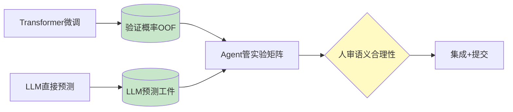

# 第16章 文本数据的 Vibe 工作流

> **本章目标**：进入第五部分——文本数据。这是 LLM 的主场，Agent 在这里有双重身份：既是“执行者”（帮你写训练代码、跑实验），又是“模型本身”（它的输出就是预测）。这种双重角色让文本竞赛的人机分工更微妙。本章建立文本 Vibe 循环，后面三章（Jigsaw、Prompt Recovery、Make Data Count）都复用它。

---

## 开篇：文本竞赛里，Agent 既是“工人”也是“材料”

前面几部分，Agent 的角色很单纯：它是工人，帮你搬砖（写代码、跑实验）。但到了文本竞赛，Agent 多了一重身份——它本身可能就是“材料”。

为什么？因为文本任务的核心是“理解语言”，而 LLM 恰恰是最懂语言的。所以你可以：
- 让 Agent 当工人：写微调代码、跑 DeBERTa 实验、管工件；
- 让 Agent 当材料：直接让 LLM 预测标签、生成弱监督、做数据增强。

这带来一个新问题：**当 Agent 既当裁判又当运动员时，你怎么保证它不“既吹哨又进球”？** 比如你让 LLM 生成训练标签，又让 LLM 评估模型——它可能倾向于“自己生成的标签”而高估效果。

所以文本竞赛的人机分工，核心是**把“生成”和“评判”分开**：Agent 生成，人评判。



---

## 16.1 现代起点：Transformer 微调 + 工件落盘

DeBERTa / RoBERTa / 开源 LLM 微调是默认强基线；RAG（检索增强生成）在需要外部知识的任务中成为常见组件。第一个微调基线必须产出验证集概率和测试预测工件。

先解释几个词：
- **Transformer**：现在几乎所有文本模型的底层架构；
- **DeBERTa / RoBERTa**：两个常用的预训练语言模型，在海量文本上预训练过，微调后用于各种任务；
- **微调**：在预训练模型后面接一个分类头，用你的数据训练；
- **RAG**：检索增强生成，先从外部知识库检索相关内容，再让模型基于这些内容回答。

```python
# src/baselines/text_baseline.py
"""
文本微调基线：DeBERTa + 分类头，产出 OOF 概率与测试预测。
用 HuggingFace Transformers 加载预训练模型。
"""
import numpy as np
import torch
from transformers import AutoModelForSequenceClassification, AutoTokenizer

MODEL_NAME = "microsoft/deberta-v3-base"


def build_model(num_labels):
    """加载预训练 DeBERTa + 分类头。"""
    return AutoModelForSequenceClassification.from_pretrained(
        MODEL_NAME, num_labels=num_labels)


def tokenize(tokenizer, texts, max_len=256):
    """分词：把文本转成模型能读的 token id。"""
    return tokenizer(texts, truncation=True, padding="max_length",
                     max_length=max_len, return_tensors="pt")
```

人检查：各类别概率分布、混淆矩阵。文本任务特别要看“模型是不是只记住了关键词而没理解语义”——比如它把“不”字忽略，导致“不好”和“好”预测一样。

---

## 16.2 Agent 做清洗，人定义“保留什么”

否定词、转折词、反讽标记是否需要特殊保留，由人根据任务语义判断；Agent 不应在未授权的情况下删除这些信号。

文本清洗比表格/图像更微妙。表格里删一列、图像里裁一块，通常没事。但文本里删一个“不”字，意思就反了。Agent 做清洗时，可能“好心”地把“无意义”的词都删了，结果把“不”“没”“除非”这些关键信号也删了。

```python
# src/features/text_clean.py
"""
文本清洗：默认保守，只去明显噪声，保留语义关键信号。
人可根据任务调整保留策略。
"""
import re


def conservative_clean(text, keep_negation=True):
    """
    保守清洗：只去多余空白、HTML 标签、URL。
    默认保留否定词、转折词、标点（它们承载语义）。
    """
    text = re.sub(r"<[^>]+>", "", text)          # 去 HTML 标签
    text = re.sub(r"http\S+", "", text)          # 去 URL
    text = re.sub(r"\s+", " ", text).strip()     # 去多余空白
    # 注意：没有删标点、没有删"不/没/除非"——这些是语义关键
    return text
```

**人定义“保留什么”**：做情感分类，“不”必须保留；做主题分类，标点可以删；做法律文本，条款编号必须保留。这些判断，Agent 给不了。

那怎么让 Agent 处理文本，又不让它把关键信号删掉？你得**明确告诉它边界**：

```
请写一个文本清洗函数，用于社区规则分类（Reddit 评论）。
要求：去 HTML 标签、去 URL、多余空白、重复标点。
注意：不要删除否定词（not / no / never / without）、
不要删除转折词（but / however）、不要删除标点，
因为这些在本任务里承载语义。
```

模型会这样回应：

```
> （思考过程）用户明确列了"不能动"的东西。我按"只删噪声、
> 不删语义"的原则实现，并在 docstring 里写清保留项，
> 避免以后有人误改。

import re

# 这些词在本任务里承载语义，明确列入"禁止删除"清单
KEEP_TOKENS = {"not", "no", "never", "without", "but", "however"}

def clean_comment(text: str) -> str:
    """
    社区规则分类专用的保守清洗。
    只删除纯噪声；否定词、转折词、标点一律保留。
    """
    text = re.sub(r"<[^>]+>", "", text)          # HTML 标签
    text = re.sub(r"http\S+|www\.\S+", "", text)  # 链接
    text = re.sub(r"\s+", " ", text).strip()      # 多余空白
    text = re.sub(r"!{2,}", "!", text)            # 重复标点压缩到1个
    # 不做小写化、不删标点、不删 KEEP_TOKENS 里的词
    return text

【我的说明】
  我没有做小写化——虽然很多 NLP 流程会做，但你的模型是
  DeBERTa（自带大小写敏感的分词），小写化反而可能损失信号。
  如果你想试小写化的收益，可以作为一组对比实验。
```

看见了吗？**它不仅照做了，还主动指出“我没有做小写化，并解释了为什么”**。这种“把每一个‘没做的事’也说明白”的习惯，能帮你审查时少漏很多坑。

---

## 16.3 特征工程的 Vibe 分化

Transformer 嵌入作为主信号；人工设计的相似度/规则特征作为多样性来源。Agent 批量生成变体，人判断语义合理性。

文本特征工程有两条路：
- **主信号**：Transformer 的嵌入向量（把文本变成几百维向量），这是最强的；
- **多样性来源**：人工设计的特征（文本长度、关键词频次、标点密度、相似度），这些和嵌入互补，集成时能涨分。

```python
# src/features/text_meta.py
"""
人工设计的文本元特征：作为 Transformer 嵌入的多样性补充。
"""
import numpy as np


def text_meta_features(texts):
    """文本长度、词数、标点密度、大写比例等。"""
    feats = []
    for t in texts:
        feats.append([
            len(t),                              # 字符数
            len(t.split()),                      # 词数
            t.count("!") + t.count("?"),         # 感叹/疑问密度
            sum(c.isupper() for c in t) / max(len(t), 1),  # 大写比例
            t.count("不") + t.count("没"),        # 否定词数（语义关键）
        ])
    return np.array(feats)
```

---

## 16.4 LLM 作为竞赛模型的使用纪律

人设定 API 预算和推理成本约束；Agent 不应在未授权的情况下消耗大量额度。

如果你直接用 LLM API 做预测（而不是微调），要特别小心成本。一次 API 调用可能几分钱，跑 10 万条测试数据就是几百块。所以：
- 人设定预算上限；
- Agent 不得自行扩大调用量；
- 优先用“缓存”（相同输入不重复调用）。

```python
# src/utils/api_budget.py
"""
API 预算控制：记录调用次数和花费，超预算就停。
"""
class APIBudget:
    def __init__(self, max_calls=10000, cost_per_call=0.001):
        self.max_calls = max_calls
        self.cost_per_call = cost_per_call
        self.calls = 0

    def can_call(self):
        return self.calls < self.max_calls

    def record(self):
        self.calls += 1
        if self.calls >= self.max_calls:
            print("⚠️ API 预算耗尽，停止调用")
```

---

## 16.5 小结

- Transformer 微调是默认强基线，工件先行；
- Agent 做清洗，但“保留什么”由人定（否定词/转折词不能删）；
- 特征工程分化：嵌入为主、人工特征为辅；
- LLM 当模型用时，预算和成本由人控制。

文本竞赛的人机分工，可以浓缩成一句：**Agent 既帮你干活、又可能亲自上场，但“它说得对不对”得你判。** 生成和评判必须分开，这是文本场景的特殊纪律。

> **下一章预告**：第 17 章 Jigsaw 社区规则分类。1st place 方案做了一个大胆判断——**直接信任 Public LB 当验证**，理由是 LB 切分随机、测试量大。这个“用 LB 还是用 CV”的选择，本身就是人判断的问题。