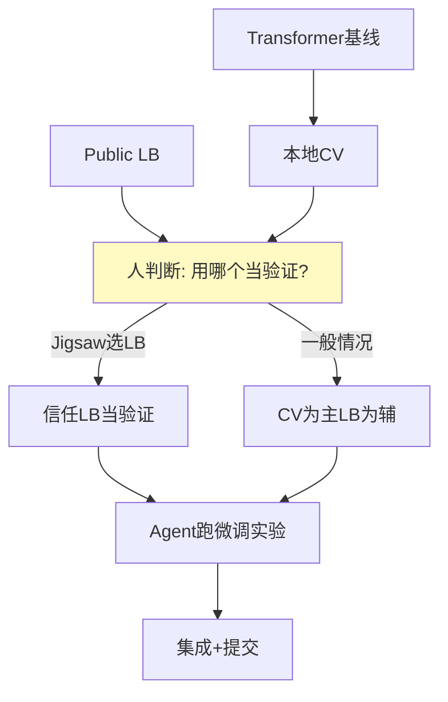

# 第17章 文本比赛详解：Jigsaw — Agile Community Rules Classification（2025，LLM 微调与验证策略的判断）

> **本章目标**：这一章讲一个特别反常识的判断。Jigsaw 的 1st place 方案，做了一个大胆的决定——**直接信任 Public LB 当验证**，理由是“LB 切分随机、测试数据量大以降低方差”。这个“用 LB 还是用 CV”的选择，本身就是**人**做出的验证方案决策。本章核心：**当验证策略本身成为判断对象时，人的角色是“选择用什么标准来判断”，而不是“让 Agent 选一个分数最高的标准”。**

---

## 开篇：这一次，“不信 CV 信 LB”反而是对的

我们前面反复讲“本地 CV 是主裁判，Public LB 是参考”。但 Jigsaw 这一章要给你一个例外。

Jigsaw 的任务是判断 Reddit 评论是否违反某个社区规则，二分类，指标是列平均 AUC（多个规则分别算 AUC 再平均）。

1st place 方案做了个反常的决定：**不主要看本地 CV，而是直接信 Public LB。** 理由是：
- LB 的切分是随机的，没有泄漏；
- 测试数据量足够大，采样噪声小；
- 文本训练/测试分布往往不完全一致，本地 CV 可能反而不准。

这是一个**人**的判断——判断“这次用 LB 当验证更靠谱”。Agent 永远不会做这种判断，因为它只会默认按“CV 最高”来优化。而如果 CV 和真实测试分布不一致，Agent 就会把你带进沟里。



---

## 17.1 比赛与数据

Reddit 评论是否违反特定社区规则，二分类，列平均 AUC，2025 年 Jigsaw 竞赛。

数据结构：
- 评论文本；
- 多个社区规则（violation 标签），每个规则一个二分类；
- 指标：每个规则的 AUC 取平均。

特点：
- 文本内容是自然语言，“理解语义”比“抓关键词”重要；
- 训练/测试可能分布不一致（不同时期、不同社区）；
- 存在“反讽、否定、隐喻”等语义难点。

---

## 17.2 Transformer 基线工件

Qwen / Llama / Phi 小模型微调基线；Agent 管理多模型工件。

```python
# src/baselines/jigsaw_baseline.py
"""
Jigsaw 基线：DeBERTa / Qwen 小模型微调，多规则二分类。
每规则独立预测概率，列平均 AUC。
"""
import torch
import torch.nn as nn
from transformers import AutoModelForSequenceClassification
from sklearn.metrics import roc_auc_score
import numpy as np


def train_one_rule(train_texts, labels, model_name="microsoft/deberta-v3-base"):
    """单个规则的微调（示意）。"""
    model = AutoModelForSequenceClassification.from_pretrained(model_name, num_labels=2)
    # ... 训练循环 ...
    return model


def col_mean_auc(y_true, y_prob):
    """列平均 AUC。"""
    aucs = [roc_auc_score(y_true[:, i], y_prob[:, i]) for i in range(y_true.shape[1])]
    return float(np.mean(aucs)), aucs
```

Agent 可以同时管多个模型（DeBERTa、Qwen、Llama），每个都产出工件，人审查哪些值得进集成。

---

## 17.3 验证策略的不可委托性（本章核心）

1st place 方案明确选择**信任 Public LB 作为验证**，理由包括 LB 切分随机、测试数据量足够大以降低方差。

**这个判断是人做出的验证方案选择**——Agent 不应自主决定“用 LB 还是 CV”。

为什么这事必须人来做？因为“用 LB 还是 CV”是个**战略性**判断，涉及：
- 本地 CV 的代表性（切分方式是否贴合真实测试）；
- 测试集大小（小测试集 LB 噪声大，不能信）；
- 提交预算（用 LB 当验证意味着要消耗很多提交，得人批准）。

```python
# src/utils/validation_strategy.py
"""
验证策略的辅助决策：帮人算"CV 和 LB 的一致性"。
这不是替人做决定，是给决定提供数据。
"""
import numpy as np


def cv_lb_consistency(cv_scores, lb_scores):
    """
    比较历次提交的 CV 和 LB 分数，算它们的相关性。
    如果高度相关（> 0.8），说明 CV 可信，可以主要用 CV；
    如果相关性低，说明 CV 不可信，要考虑用 LB（但消耗预算）。
    """
    if len(cv_scores) < 3:
        print("提交次数太少，无法评估一致性")
        return None
    corr = np.corrcoef(cv_scores, lb_scores)[0, 1]
    print(f"CV 与 LB 相关性：{corr:.3f}")
    if corr > 0.8:
        print("→ CV 可信，主用 CV")
    else:
        print("→ CV 不可信，考虑用 LB（需人批准预算）")
    return corr
```

> **在文本竞赛中，训练/测试分布往往不完全一致，验证策略的选择本身就是一个需要人判断的问题。** Agent 只会默认选 CV，你得判断这次 CV 到底靠不靠谱。

---

## 17.4 Agent 执行微调实验，人审核损失掩码与数据增强

1st place 方案在微调时**手动排除 “Yes”/“No” 之外的 token 的损失**，并利用 test.csv 中的正负例进行上采样。这些操作由人设计，Agent 批量执行不同配置的工件。

**损失掩码**是什么？训练语言模型时，通常对每个 token 都算损失。但如果你的任务是“让模型回答 Yes/No”，那你只关心它回答对没对，不关心它中间的推理过程。损失掩码就是“只在 Yes/No 这两个 token 上算损失，其他地方不算”。

```python
# src/train/loss_mask.py
"""
损失掩码：只对答案 token（Yes/No）算损失，忽略其他 token。
人设计掩码规则，Agent 批量执行。
"""
import torch
import torch.nn.functional as F


def masked_loss(logits, labels, answer_token_mask):
    """
    logits: 模型输出 (B, T, V)
    labels: 真实 token (B, T)
    answer_token_mask: 布尔张量 (B, T)，True 表示这个位置是答案 token
    """
    shift_logits = logits[..., :-1, :].contiguous()
    shift_labels = labels[..., 1:].contiguous()
    mask = answer_token_mask[..., 1:].contiguous()
    # 逐 token 交叉熵，再只对答案位置求和
    loss = F.cross_entropy(
        shift_logits.view(-1, shift_logits.size(-1)),
        shift_labels.view(-1), reduction="none")
    loss = loss * mask.view(-1)
    return loss.sum() / mask.sum().clamp(min=1)
```

**人为啥要设计这个**？“只在答案 token 算损失”是一个经验判断——它让模型聚焦于“答对”，而不是“把推理过程写得漂亮”。这个设计来自对任务的理解决定，Agent 不会主动想到。

如果 Agent 没想到，你可以把设计意图告诉它，但让它来实现细节：

```
我要做的是"评论是否违反社区规则"的二分类，用 LLM 微调。
我想只让模型在最终输出的 Yes/No 两个 token 上算损失，
中间的推理 token 不算损失，这样模型更专注于答对。
请实现这个损失掩码，并说明怎么定位答案 token。
```

模型会这样回应：

```
> （思考过程）用户已有明确设计意图，我要做的是实现细节。
> 关键点是"怎么找到答案 token 的位置"：因为模型输出序列
> 里只有最后一个非 padding 位置是答案，所以我用 attention_mask
> 找出每行最后一个有效 token，再检查该位置的 token id
> 是否属于 Yes/No 词表。

def build_answer_mask(input_ids, attention_mask, yes_id, no_id):
    """
    构造答案位置掩码：只标记每行最后一个有效 token，
    且该 token 属于 Yes/No 词表时才标记为 1。
    """
    seq_len = input_ids.size(1)
    # 每行最后一个有效位置（attention_mask 从右往左第一个 1）
    last_idx = attention_mask.size(1) - 1 - attention_mask.flip(1).argmax(1)
    mask = torch.zeros_like(input_ids, dtype=torch.bool)
    rows = torch.arange(input_ids.size(0))
    tok = input_ids[rows, last_idx]
    mask[rows, last_idx] = (tok == yes_id) | (tok == no_id)
    return mask

【设计要点说明】
1. 为什么用"最后一个有效 token"而不是搜 Yes/No：
   推理文本里也可能出现 "yes"（比如"yes, it is rude"），
   全文搜索会标错位置。
2. 如果末尾 token 不是 Yes/No（比如模型输出的是"Sure."），
   该行掩码全 0，这行就不参与损失。我会打印这类样本比例，
   太高说明提示词或解码策略要调。
```

它不仅实现了，还**解释了关键设计取舍**（为什么不用全文搜索、异常情况怎么处理）。这种“解释为什么”比“解释怎么做”更有价值——因为后者你能自己看代码，前者才是它真正的思考。

---

## 17.5 集成与提交

```python
# src/ensembles/weighted_blend.py
"""多模型工件加权集成 + 提交核对。"""
import numpy as np


def weighted_blend(oofs, weights):
    w = np.array(list(weights.values()))
    w = w / w.sum()
    return np.tensordot(w, np.stack(list(oofs.values())), axes=(0, 0))
```

提交前用第 4 章的 `make_submission` 核对。

---

## 17.6 小结

**当验证策略本身成为判断对象时，人的角色是“选择用什么标准来判断”，而不是“让 Agent 选一个分数最高的标准”。**

- 信任 LB 当验证，是一个需要人拍板的战略判断；
- 损失掩码、数据上采样，由人设计、Agent 执行；
- CV 与 LB 一致性算出来给人看，决定由人下。

这一章最反直觉也最重要：**有时候，“用 CV 验证”这个我们一直强调的原则，反而要被人推翻。** 为什么？因为 CV 的有效性依赖于“本地切分能代表真实测试”——如果这个前提不成立，CV 就不可信。**验证方案本身，永远是需要人判断的对象。**

> **下一章预告**：第 18 章 LLM Prompt Recovery，进入生成式任务。生成式的评估指标往往抓不住“语义质量”，人得靠人工抽检来判断 Agent 优化的方向有没有偏。