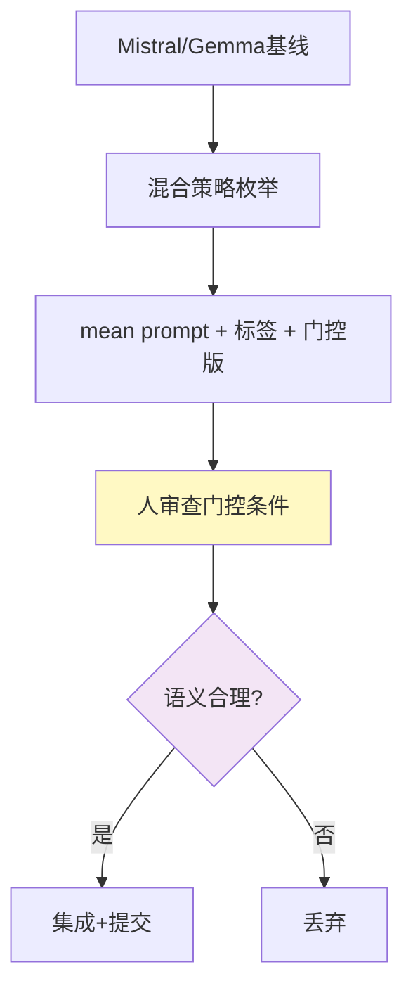

# 第18章 文本比赛详解：LLM Prompt Recovery（2024，生成式任务中的混合策略判断）

> **本章目标**：进入“生成式任务”的世界。这类任务预测的不是一个类别，而是一段文本。评估指标常常抓不住“语义质量”——比如两段语义一样但措辞不同的提示词，指标可能给很低分。所以这一章的核心是：**“什么是好输出”的判断，不能完全交给指标，更不能完全交给 Agent，得靠人工抽检工件。**

---

## 开篇：生成式任务里，指标会“看不懂”

之前的比赛（分类、回归），预测输出是个数字或概率，指标算出来很客观。但 LLM Prompt Recovery 不同——它要你**从改写后的文本恢复原始提示词（prompt）**。

输出是一段文本。怎么分“好坏”？
- 指标可能用 BLEU、ROUGE、编辑距离这些“字面重叠”指标；
- 但“原始提示词”可能有好几种改写方式，字面不同但语义一样——指标就给低分；
- 反之，字面很像但语义偏差了，指标却高。

所以生成式任务里，**指标是“参考”，不是“绝对真理”**。人必须抽检生成的 prompt 工件，看语义是不是真的恢复了，而不是只信指标分数。



---

## 18.1 比赛与数据

从改写后的文本恢复原始 prompt，评估指标与语义相似度相关，2024 年 Google 竞赛。

数据结构：
- 改写后的文本（输入）；
- 原始 prompt（目标）；
- 指标：语义相似度相关（可能包含 BLEU/ROUGE，但不完全等同）。

难点：同一个 prompt 可以有很多种改写，所以“只有一个标准答案”的假设不成立。

---

## 18.2 自动基线工件

Mistral / Gemma 等 LLM 微调的基线工件。

```python
# src/baselines/prompt_recovery_baseline.py
"""
LLM Prompt Recovery 基线：Mistral / Gemma 微调。
输入改写文本，输出恢复后的原始 prompt。
"""
from transformers import AutoModelForCausalLM, AutoTokenizer


def build_baseline(model_name="mistralai/Mistral-7B-v0.1"):
    """加载基础 LLM，准备微调。"""
    model = AutoModelForCausalLM.from_pretrained(model_name)
    tokenizer = AutoTokenizer.from_pretrained(model_name)
    return model, tokenizer
```

人检查：生成的 prompt 是否语义通顺？和原始 prompt 是否表达了同一个意思？

---

## 18.3 Agent 枚举混合策略，人判断“均值 prompt + 模型预测”的组合

3rd place 方案采用 **“mean prompt + 标签 + 完整 prompt（如果通过门控）”** 的混合策略。Agent 可以批量生成不同组合的工件；人判断门控条件是否在语义上合理。

**“mean prompt”是什么？** 把训练集里所有训练样本的原始 prompt“平均”成一个代表性提示（粗略理解为取共同模板、常用词）。当模型不确定时，就用这个“平均提示”兜底，而不是瞎猜。

```python
# src/features/prompt_mix.py
"""
混合策略：mean prompt + 标签 + 门控版完整 prompt。
Agent 枚举组合，人判断门控条件。
"""
def mean_prompt(prompts):
    """把多个 prompt 取公共模板（示意：实际用字符串对齐/聚类）。"""
    # 占位：实际可用最长公共子序列或去除差异后拼接
    return " ".join(set(" ".join(prompts).split()))


def mix_strategy(model_pred, mean_prompt, label, gate_pass):
    """
    门控：门控条件通过时，用完整 prompt 预测；否则用 mean prompt。
    """
    if gate_pass:
        return model_pred
    return mean_prompt
```

**人判断“门控条件是否在语义上合理”**：比如，什么情况下模型预测应该被“mean prompt”覆盖？如果门控条件本身有语义偏差（比如只在长度短时用 mean prompt），那可能系统性地丢掉短 prompt 里的关键信息。这个偏差，指标看不出来，人看出来。

---

## 18.4 生成式任务的验证特殊性

生成式任务的评估指标可能无法完全捕捉语义质量；人需要通过人工抽检工件来判断 Agent 优化的方向是否偏离。

**人工抽检的具体做法**：
1. 从测试集抽 50 个样本；
2. 把“原始 prompt”“模型生成的 prompt”并排摆出来；
3. 看语义是否一致，而不是看字面重叠；
4. 如果发现系统性偏差（比如模型总漏掉某个关键词），回去改策略。

这个步骤 Agent 不能代替你——它不懂“语义是否真的对”，只懂“指标分数高低”。

---

## 18.5 提交

```python
# 生成提交文件：把模型生成的 prompt 填入 sample_submission
import pandas as pd


def make_prompt_submission(generated_prompts, sample_path, out_path,
                           id_col="id", target_col="prompt"):
    sample = pd.read_csv(sample_path)
    sub = sample.copy()
    sub[target_col] = generated_prompts
    sub.to_csv(out_path, index=False)
    print(f"✅ Prompt 提交文件已生成：{out_path}")
```

提交前，人还要过一遍“人工抽检”清单：抽 50 个，看语义。

---

## 18.6 小结

**生成式文本任务中，“什么是好输出”的判断不能完全交给指标，更不能完全交给 Agent。**

- 字面重叠指标（BLEU/ROUGE）不等于语义正确；
- 混合策略的门控条件，得靠人判断语义合理性；
- 人工抽检工件，是生成式任务的必备环节。

这一章给所有“文本生成”类任务一个通用提醒：**指标只是一面镜子，有时候它照得模糊。这时候你得自己把生成的文本拿出来看一眼，而不是等着指标告诉你对不对。**

> **下一章预告**：第 19 章 Make Data Count，进入“检索 + 分类”的混合流程。两阶段任务里，人判断的重点不再是“单个阶段的分数”，而是“阶段之间的误差传播”。