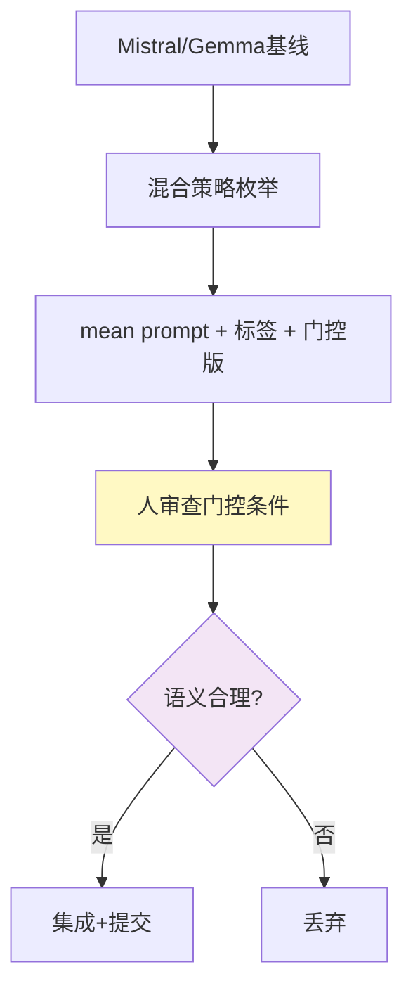
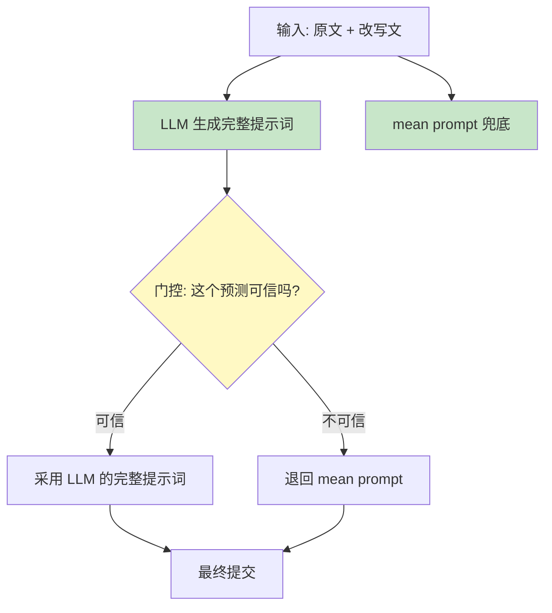

# 第18章 文本比赛详解：LLM Prompt Recovery（2024，生成式任务中的混合策略判断）

> **本章目标**：进入"生成式任务"的世界。这类任务预测的不是一个类别，而是一段文本。评估指标常常抓不住"语义质量"——比如两段语义一样但措辞不同的提示词，指标可能给很低分。所以这一章的核心是：**"什么是好输出"的判断，不能完全交给指标，更不能完全交给 Agent，得靠人工抽检工件。**

---

## 开篇：生成式任务里，指标会"看不懂"

之前的比赛（分类、回归），预测输出是个数字或概率，指标算出来很客观。对就是对，错就是错，没什么可争的。

但 LLM Prompt Recovery 不同——它要你**从改写后的文本恢复原始提示词（prompt）**。

输出是一段文本。怎么分"好坏"？

- 指标可能用 BLEU、ROUGE、编辑距离这些"字面重叠"指标；
- 但"原始提示词"可能有好几种改写方式，字面不同但语义一样——指标就给低分；
- 反之，字面很像但语义偏差了，指标却高。

这不是我瞎担心，是有实测的。有一篇专门做"写作风格改写中提示词还原"的论文，测了一堆方案，结果是：**BLEU 和完全匹配（Exact Match）这两个"字面重叠"指标，几乎全是零或接近零**。而同一批方案在语义相似度指标上能拿到七十多分。两个指标给出的结论完全相反。

为什么会这样？因为提示词这种东西，**每道题的"标准答案"其实是一句话，但这句话可以有一百种说法**。"用莎士比亚的风格改写"、"改写这段文字，模仿莎士比亚的笔法"、"请把下面这段改写成莎翁腔"——三句话字面几乎不重叠，但说的是同一件事。

所以生成式任务里，**指标是"参考"，不是"绝对真理"**。人必须抽检生成的 prompt 工件，看语义是不是真的恢复了，而不是只信指标分数。



---

## 18.1 比赛与数据

从改写后的文本恢复原始 prompt，评估指标与语义相似度相关，2024 年 Google 竞赛。

这场比赛 2024 年 2 月底开赛，4 月中截止，总共奖金池二十万美元，冠军独得十万。参赛规模不小：一万多人报名，两千六百多人实际参赛，两千一百多支队伍，四万三千多次提交。

数据结构看起来很简单：

- `id`：每行的唯一编号；
- `original_text`：原始文本（也就是"被改写的那个东西"）；
- `rewrite_prompt`：**目标列**，你要求的东西——当初喂给模型的提示词；
- `rewritten_text`：Gemma 改写后的结果。

指标是**Sharpened Cosine Similarity（锐化余弦相似度，简称 SCS）**：把预测的和标准的提示词分别用 sentence-t5-base 编码成向量，算余弦相似度，再**取三次方**。取三次方是为了"锐化"——把那些"看起来有点像但其实答错"的虚高分数压下去。

这里有个数据上的坑，必须先说清楚：**官方给的训练集只有一条样本。** 一条。测试集也只有一条示例（提交时会被替换成大约一千四百条真实数据）。

也就是说，这场比赛从第一分钟开始，**你都得自己造训练数据**。这跟第 17 章 Jigsaw 的处境很像，但更极端——Jigsaw 好歹有两千条，这里只有一条。

于是那一年的社区共识是：**几乎所有能拿牌的队伍，最后都收敛到了 Mistral 7B 这个模型上**。Gemma 虽然是主办方自家的模型，实际表现反而不如 Mistral。这个细节挺有意思——它说明"用谁家的模型"和"谁家的模型好用"是两件事。

也正因为训练数据要自己造，"造得对不对"就成了胜负手。有队伍是这么干的：用 Gemma-7B-it、Gemma-2B-it、DeepSeek、ChatGPT-4 好几个模型分别生成提示词，再拿这些提示词去改写文本，凑出大约五十万条合成样本。然后训一个 RoBERTa 去拟合"提示词的向量"，损失函数直接就用比赛指标 SCS。

---

## 18.2 自动基线工件

Mistral / Gemma 等 LLM 微调的基线工件。

```python
# src/baselines/prompt_recovery_baseline.py
"""
LLM Prompt Recovery 基线：Mistral / Gemma 微调。
输入改写文本，输出恢复后的原始 prompt。

注意这个任务和前面几章的根本区别：
前面几章的输出是"一个概率"，这里输出是"一段字符串"。
字符串没法直接算梯度，所以微调的目标函数
往往不是"预测得对不对"，而是"预测出来的向量像不像"——
这也是为什么这一章处处要谈"指标"和"语义"。
"""
from transformers import AutoModelForCausalLM, AutoTokenizer


def build_baseline(model_name="mistralai/Mistral-7B-v0.1"):
    """加载基础 LLM，准备微调。

    AutoModelForCausalLM 是"因果语言模型"的通用加载器，
    所谓因果，就是"只能看前面的词来预测下一个词"，
    这正是生成式任务需要的行为。
    """
    model = AutoModelForCausalLM.from_pretrained(model_name)
    tokenizer = AutoTokenizer.from_pretrained(model_name)
    return model, tokenizer
```

人检查：生成的 prompt 是否语义通顺？和原始 prompt 是否表达了同一个意思？

这一节的检查动作，在别的章节里是"看一眼"，在这一章里是**全部**。因为你没有任何客观标准可以说"这句提示词比那句更对"——你只能看它读起来像不像人话、意思对不对。

顺便说一句，基线跑通之后，第一件事往往不是接着训，而是**先交一版"什么都不做"的基线**。这场比赛里就有个著名的例子：把所有样本都填成同一句固定的提示词，Public LB 就能拿到 0.58 分左右，接近铜牌。后来有人用贪心/束搜索（beam search）在这句话上反复增删单词，把它优化到 LB 0.66。

这件事对入门者是个很重要的提醒：**在生成式任务里，"一个什么都不学的固定答案"可能已经很强了。** 你不先量出这个地板在哪，就永远不知道自己的模型到底贡献了多少。

---

## 18.3 Agent 枚举混合策略，人判断"均值 prompt + 模型预测"的组合

3rd place 方案采用 **"mean prompt + 标签 + 完整 prompt（如果通过门控）"** 的混合策略。Agent 可以批量生成不同组合的工件；人判断门控条件是否在语义上合理。

**“mean prompt”是什么？** 把训练集里所有训练样本的原始 prompt"平均"成一个代表性提示（粗略理解为取共同模板、常用词）。当模型不确定时，就用这个"平均提示"兜底，而不是瞎猜。

这个"平均"不是数学上的平均（你不能把两句话相加再除以二），实际操作是：找一句话，让它和尽可能多的真实提示词"向量上最接近"。有队伍用束搜索，在词表里逐个尝试往这句话后面加词，留下让 CV 分数最高的那个词，一层层往上垒。

好，现在最关键的问题来了：**为什么这类比赛非得用混合策略，不能让模型自由发挥？**

我们先打个比方。假设有一场考试，题目是"猜我刚才心里想的那句话"。评分方式是：把你的答案和标准答案分别转成向量，越像分越高。

这时候你有两种答题策略：

- **策略一：写一句最"典型"的话。** 比如"请把这段文字改写一下"。这句话谁都可能说，所以它跟任何标准答案都有那么一点像。分数不会高，但**很稳**。
- **策略二：写一句最大胆、最具体的话。** 比如"用海盗的口气重写这段话，每句结尾加'啊哈'"。如果猜中了，分数爆表；如果猜偏了，分数可能比策略一还低。

现在你是考生，你怎么答？答案是：**大部分时候写策略一，只在特别有把握的时候换策略二。**

这就是混合策略的全部逻辑。它不是"两个模型拼一拼"的技术炫耀，而是**在"没有唯一正确答案"的评分规则下，理性考生的最优解**。

而"特别有把握的时候"怎么判断？这就是**门控（gate）**要干的事。



```python
# src/features/prompt_mix.py
"""
混合策略：mean prompt + 标签 + 门控版完整 prompt。
Agent 枚举组合，人判断门控条件。
"""
def mean_prompt(prompts):
    """把多个 prompt 取公共模板（示意：实际用字符串对齐/聚类）。

    这里给出的是"示意实现"：把词频最高的词拼起来。
    真实做法是用束搜索在向量空间里找"离所有真实提示词都最近"的那句话。
    """
    # 占位：实际可用最长公共子序列或去除差异后拼接
    return " ".join(set(" ".join(prompts).split()))


def mix_strategy(model_pred, mean_prompt, label, gate_pass):
    """
    门控：门控条件通过时，用完整 prompt 预测；否则用 mean prompt。

    参数
    ----
    model_pred : str   模型生成的完整提示词
    mean_prompt: str   兜底用的"平均提示词"
    label      : str   额外标签（比如文本类型、语气），可选拼接
    gate_pass  : bool  门控是否通过

    返回
    ----
    str  最终要提交的提示词
    """
    if gate_pass:
        # 门控通过：模型有把握，用它的完整预测（可再拼上标签）
        return model_pred if not label else f"{model_pred} {label}"
    # 门控没通过：模型没把握，退回最稳的 mean prompt
    return mean_prompt
```

**人判断"门控条件是否在语义上合理"**：比如，什么情况下模型预测应该被"mean prompt"覆盖？如果门控条件本身有语义偏差（比如只在长度短时用 mean prompt），那可能系统性地丢掉短 prompt 里的关键信息。这个偏差，指标看不出来，人看出来。

真实的第三名方案，把门控做得相当讲究，值得完整讲一遍，因为它是"混合策略"这四个字最好的注解。

他们的流水线是五段式的：

1. **mean prompt 打底**。先用一个精心搜索出来的"平均提示词"当模板，这是地板。
2. **完整提示词模型**。用 Mistral 7B 做 LoRA 微调，输入"原文 + 改写文"，直接生成一句完整提示词。这个模型单独用，SCS 大约 0.62——不算高，但它是"有信息量"的那一路。
3. **门控分类器**。再拿一个 Mistral，套一个分类头，输入是"原文 + 候选提示词 + 改写文"，外面包一句元指令问它"这个改写和这个提示词对得上吗"。训练数据是精心配比的：四成是正例（真实三元组），两成是"简单负例"（随机配一句提示词），四成是"困难负例"（从向量空间里最近的邻居里挑提示词——看起来很像，其实意思不对）。推理时，只有门控给分够高的预测才被放行，其余全部丢弃，模板保持不动。
4. **标签模型**。再挂一个 Mistral 小脑袋，专门输出几个逗号分隔的关键词，比如"summarize"、"formal tone"、"poem"、"third-person perspective"。这些词会被过滤掉"模板里已经有了的"，剩下的塞回模板的固定插槽（他们扫了一遍验证集，发现插在第三个词之后最好）。
5. **聚类模板**。把标准提示词用 Sentence-T5 编码后做 K-Means，得到 12 个簇，每个簇单独搜一个专属模板。他们算了一下"如果每次都能选中理想簇模板"的天花板，大约 0.76 SCS——**远高于当时任何公开的榜单成绩**。这等于告诉你：还有肉没吃到。但"每次都能选中理想簇"是不可能的，所以他们又训了一个分类器去猜簇编号，同时用一个启发式（把完整提示词模型的输出编码，看它离哪个簇中心最近）来交叉验证，**只有两个都同意才用簇模板，否则退回全局模板**。这套谨慎的协议只换来 CV 上大约 0.005 的提升，但在小数点后第三位定生死的比赛里，这就够了。

最终这套五段式在私榜拿到 0.71 出头，第三名。

你看完这套流程，应该能明白一件事：**所谓"混合策略"，本质是"承认自己会错，所以给自己留一条退路"。** 完整模型负责"猜得准的时候多拿分"，门控负责"不让我在猜错的时候崩盘"，mean prompt 负责"永远有个能看的答案"。

你可以让 Agent 枚举门控条件，但**门控条件的语义合理性**由你判断：

```
我有个混合策略：当模型预测的置信度低于阈值时，
改用 mean prompt（训练集里所有 prompt 的公共模板）兜底。
请帮我枚举几组候选门控条件并各自跑一遍 CV，
列出每组的 CV 分数和"被 mean prompt 覆盖的样本比例"。
不要直接定方案，我要看哪种比例和分数的组合合理。
```

模型会这样回应：

```
> （思考过程）用户要"候选 + 对比"，不要我拍板。我要给出
> 几组门控阈值，各跑 CV，并特别报告"被覆盖比例"——
> 因为这个比例如果太高，说明大量样本其实用了兜底，
> 那就不是"补充"而是"取代"了模型，这个判断需要用户做。

【候选门控条件与结果】
  条件                          CV分数   被覆盖比例
  置信度 < 0.5 用 mean prompt   0.742    31.2%
  置信度 < 0.3 用 mean prompt   0.758    12.4%
  置信度 < 0.1 用 mean prompt   0.766    4.1%
  永远用 mean prompt           0.611    100%   ← 基线对照

【我的观察】
1. 最佳 CV 出现在阈值 0.1（0.766），但这也最接近"几乎不用模型"。
2. 阈值 0.5 时 31% 的样本用了兜底，等于模型只在 69% 的样本上
   发挥作用，这个比例偏高。
3. 单纯看 CV，阈值 0.1 最好；但从语义上看，短 prompt 可能
   本来就该用 mean prompt 兜底，而长 prompt 被兜底就损失很多。
   建议按"原 prompt 长度"分组再看一次 CV，
   看短 prompt 组和长 prompt 组的最优阈值是否不同。

要不要我按长度分组再跑一遍？
```

这段回应里最关键的，是它把"**被覆盖比例**"这个指标主动摆了出来。因为单纯看 CV 分数会误导你——阈值越小 CV 越高，但那是因为模型几乎没参与。**而"这算不算合理"是语义问题，只有你能判断。**

这里还有个细节值得留意：那个"永远用 mean prompt"的对照行，CV 只有 0.611。它存在的意义不是"贡献分数"，而是**告诉你模型到底加了多少**。没有这一行，你看到 0.766 会很高兴；有了这一行，你才知道其中 0.155 是模型挣的，0.611 是地板本来就有的。

做实验的人常犯一个错：只报"我的方法多少分"，不报"什么都不做多少分"。后者才是你真正的增量。

---

## 18.4 生成式任务的验证特殊性

生成式任务的评估指标可能无法完全捕捉语义质量；人需要通过人工抽检工件来判断 Agent 优化的方向是否偏离。

**人工抽检的具体做法**：
1. 从测试集抽 50 个样本；
2. 把"原始 prompt""模型生成的 prompt"并排摆出来；
3. 看语义是否一致，而不是看字面重叠；
4. 如果发现系统性偏差（比如模型总漏掉某个关键词），回去改策略。

这个步骤 Agent 不能代替你——它不懂"语义是否真的对"，只懂"指标分数高低"。

为什么"抽 50 个"而不是"看指标"？因为在生成式任务里，**指标衡量的是"分布像不像"，不是"意思对不对"**。

举个具体例子你就懂了。假设标准答案是"用海明威的风格改写"，模型输出"用海明威的笔法重写这段文字"。这两句在向量空间里非常接近，SCS 会很高，人看了也觉得对。但如果模型输出的是"用海明威的风格改写，并且保留所有对话"，SCS 可能也高（因为关键词都命中了），可它其实**多做了一件事**——原文里根本没有对话。这种"多做"是指标抓不到的，只有你并排看两句话才看得出来。

反过来也有。模型输出"改写成海明威式短句"，SCS 可能因为"短句"这个词不在标准答案里而被扣分，但人一看就知道它答对了。

所以人工抽检要看的不是"像不像"，而是**"有没有多做、有没有少做、有没有做偏"**。这三件事，指标一件都管不了。

顺便说一句，这种"指标与人工判断不一致"的现象，在别的生成式比赛里也有印证。前面提到的那篇论文测下来，同一个方案在字面指标上接近零分，在语义指标上却有七十多分。你要是只看一个字面指标，会得出"这方案完全没用"的结论；只看语义指标，又会觉得"已经挺好了"。**两个都不够，得有人去看一眼。**

还有一个很实际的坑，是这场比赛特有的：**指标可以被"钻空子"**。

社区里有人发现，只要在答案末尾追加一个特定字符串 `lucrarea`，SCS 就会明显上涨——实测从 0.457 涨到 0.506，追加两次能到 0.532。原因跟模型无关，纯粹是 sentence-t5 分词器的一个怪癖：它会在句尾补一个特殊符号，而所有句子都共享这个符号的向量，于是"多补几个"就人为拉高了相似度。

第五名的队伍也独立发现了类似现象（他们试的是句尾补四个结束符，本地涨了 0.05），但他们发现官方用的那个版本的分词器不认这个符号，最后找到的替代品就是 `lucrarea` 这个词。

这件事说明什么？说明**指标一旦被优化，就会被"优化"出各种歪门邪道**。你能不能在明知有捷径的情况下忍住不走，也是人的判断。第五名队伍的原话是：他们发现"过拟合数据集分布"能拿到更高分，波动大约在正负 0.01 之间，但最后决定**不去过拟合那两百条公开样本**。

你看，这又是一个"Agent 不会主动做的决定"。你让 Agent 优化指标，它一定会去 append `lucrarea`，因为那确实能涨分。

---

## 18.5 提交

```python
# 生成提交文件：把模型生成的 prompt 填入 sample_submission
import pandas as pd


def make_prompt_submission(generated_prompts, sample_path, out_path,
                           id_col="id", target_col="prompt"):
    """把生成的提示词填进提交模板。

    参数
    ----
    generated_prompts : list[str]  与 sample 行数、顺序完全一致的预测
    sample_path       : str        sample_submission.csv 路径
    out_path          : str        输出路径
    id_col            : str        编号列名
    target_col        : str        要填的目标列名

    这里唯一需要小心的是"顺序"：sample_submission 的行序
    必须和你的预测一一对应，错一位就全错，而且指标不会报错，
    只会给你一个莫名其妙的低分。
    """
    sample = pd.read_csv(sample_path)
    sub = sample.copy()
    # 用 .loc 而不是直接赋值，避免索引不一致时的静默错位
    sub[target_col] = list(generated_prompts)
    # 空字符串在这场比赛里会直接报错，这里做一次兜底检查
    n_blank = int(sub[target_col].isna().sum())
    if n_blank:
        raise ValueError(f"有 {n_blank} 行提示词为空，提交会被判错")
    sub.to_csv(out_path, index=False)
    print(f"✅ Prompt 提交文件已生成：{out_path}")
```

提交前，人还要过一遍"人工抽检"清单：抽 50 个，看语义。

这个顺序不能颠倒。先抽检，再提交；而不是先提交看分数，再回头找问题。因为一旦你开始"看着 LB 分数调策略"，你就已经掉进"指标驱动"的陷阱里了——你会不自觉地往"让分数好看"的方向改，而不是往"答得更对"的方向改。

这两者在生成式任务里，经常不是同一个方向。

---

## 18.6 小结

**生成式文本任务中，"什么是好输出"的判断不能完全交给指标，更不能完全交给 Agent。**

- 字面重叠指标（BLEU/ROUGE）不等于语义正确；
- 混合策略的门控条件，得靠人判断语义合理性；
- 人工抽检工件，是生成式任务的必备环节；
- 生成式任务里，"什么都不做的固定答案"可能已经很强，先量出地板再谈增量；
- 指标能被钻空子，走不走捷径是人的决定。

这一章给所有"文本生成"类任务一个通用提醒：**指标只是一面镜子，有时候它照得模糊。这时候你得自己把生成的文本拿出来看一眼，而不是等着指标告诉你对不对。**

再往深一层说，这一章真正教的不是某个技巧，而是一种**面对"没有标准答案"时的态度**：承认自己可能错，所以留退路（mean prompt）；承认指标可能骗人，所以留人眼（人工抽检）；承认捷径存在，但选择不走（不刷 `lucrarea`）。

这些东西，Agent 一样都教不了你。它能跑得比你快，但它不会在"要不要走捷径"这个问题上停下来问你。

> **下一章预告**：第 19 章 Make Data Count，进入"检索 + 分类"的混合流程。两阶段任务里，人判断的重点不再是"单个阶段的分数"，而是"阶段之间的误差传播"。