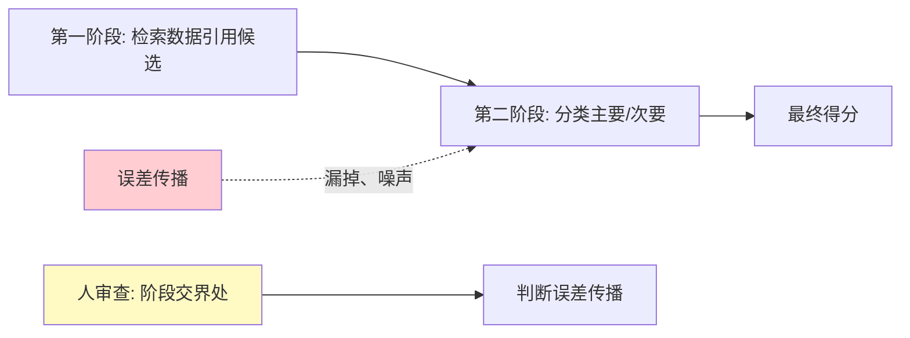

# 第19章 文本比赛详解：Make Data Count — Finding Data References（2025，检索 + 分类的混合流程）

> **本章目标**：看一个“两阶段混合”的文本任务。Make Data Count 要从科学论文全文里识别数据引用，并分类为主要/次要引用。1st place 用 CatBoost 训练，4th place 用 Qwen2.5 预训练。关键不是“单个阶段得分高”，而是**“阶段之间的误差怎么传播”**——人审查的重点在阶段交界处，而不是单阶段的分数。

---

## 开篇：两阶段任务里，最致命的不是“第一阶段错了”，而是“错传给了第二阶段”

Make Data Count 是个“检索 + 分类”的混合流程：
- 第一阶段（检索）：在科学论文全文里找出“哪里可能提到了数据集”；
- 第二阶段（分类）：把找到的候选分成“主要引用”或“次要引用”。

这类任务有一个表格/图像任务里没有的问题：**误差会传递**。如果第一阶段检索漏了某个引用，第二阶段再怎么强，也只能对“找到的”东西分类，漏掉的永远回不来了。如果第一阶段把大量无关段落也当成候选，第二阶段的分类精度会被稀释。

所以这一章教你：**人审查的重点在阶段交界处，而不是单阶段的分数。**



---

## 19.1 比赛与数据

从科学论文全文中识别数据引用并分类为主要/次要引用，2025 年竞赛。

数据结构：
- 科学论文全文（大段文本）；
- 目标：哪些句子/段落提到了数据集，且属于“主要”（paper 自身贡献的数据）还是“次要”（引用他人的数据）。

特点：
- 长文本，信息稀疏（大部分段落不提数据集）；
- 类别不平衡（次要引用可能很少）；
- 两阶段：先“找”，再“分类”。

---

## 19.2 自动基线：检索 + 分类两阶段工件

1st place 方案使用论文和数据集元数据训练 CatBoost；4th place 使用 EuropePMC 论文生成合成标签用于 Qwen2.5 预训练。基线工件包括检索结果和分类概率。

```python
# src/pipelines/two_stage.py
"""
Make Data Count 两阶段流水线。
阶段一：检索候选句子；阶段二：分类主要/次要引用。
人审查阶段交界处，防误差传播。
"""
import numpy as np


def stage1_retrieve(texts, keyword_or_model):
    """阶段一：检索可能提到数据集的候选句子。返回布尔掩码。"""
    # 示意：按关键词或检索模型打分，返回 top-K 候选
    return np.array([True if "dataset" in t.lower() else False for t in texts])


def stage2_classify(candidates, model):
    """阶段二：对候选做主要/次要引用分类，返回概率。"""
    return np.random.rand(len(candidates))  # 占位
```

人检查：阶段一漏掉了什么？把什么误报为候选？阶段二的精度是在“干净候选”上算的，还是在“噪声候选”上算的？

---

## 19.3 Agent 管理两阶段实验，人判断稀有类别的处理

Agent 可以批量尝试不同的检索策略和分类器组合；人判断**检索阶段的假阳性/假阴性对最终分数的影响**，以及次要引用这类稀有类别的处理方式。

两个关键判断：
1. **检索阶段的假阴性（漏检）**：一次漏掉，第二阶段永远救不回来。这是最严重的错误类型。
2. **稀有类别（次要引用）**：样本少，模型容易全预测成“主要引用”。人要看每个类别的召回率，不能只看整体准确率。

```python
# src/utils/error_propagation.py
"""
误差传播分析：估算阶段一假阴性对最终分数的上限影响。
"""
def leakage_upper_bound(recall_stage1):
    """
    阶段一召回率越低，最终 F1 的上限越低。
    即使阶段二完美（F1=1），最终也不超过 recall_stage1。
    """
    return recall_stage1


def stage_metrics(stage1_correct, stage1_total, stage2_correct, stage2_total):
    r1 = stage1_correct / max(stage1_total, 1)
    r2 = stage2_correct / max(stage2_total, 1)
    print(f"阶段一召回率：{r1:.3f}（这是最终上限）")
    print(f"阶段二召回率：{r2:.3f}")
    print(f"最终理论上限 ≈ {min(r1, r2):.3f}")
```

---

## 19.4 提交

```python
# 两阶段结果合并 + 提交核对
import pandas as pd


def make_submission(final_predictions, sample_path, out_path, id_col="id", target_col="label"):
    sample = pd.read_csv(sample_path)
    sub = sample.copy()
    sub[target_col] = final_predictions
    sub.to_csv(out_path, index=False)
    assert len(sub) == len(sample), "行数不一致"
    print(f"✅ 两阶段提交已生成：{out_path}")
```

---

## 19.5 小结

**多阶段文本流程中，人的判断集中在“阶段之间的误差传播”上，而不是单个阶段的分数。**

- 第一阶段漏检（假阴性）不可逆，上限就是阶段一的召回率；
- 次要引用等稀有类别，要看每类召回率而非整体准确率；
- Agent 批量搜策略，人盯“误差怎么传”。

这一章给所有“流水线”任务（检索+分类、OCR+NLP、视频处理等）一个通用提醒：**最弱的一环决定天花板，人得盯着交界处，而不是只看终点的分数。**

> **第五部分（文本）结束。** 第 20 章开始进入“进阶与迁移”——验证与评估，Vibe 时代更不可让渡的判断；调优与集成；策略与心态；从竞赛到实际项目。