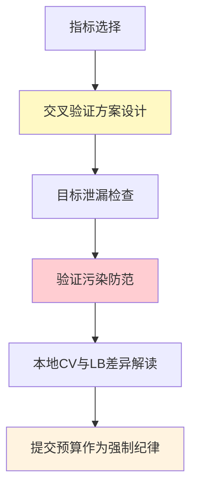

# 第20章 验证与评估：Vibe 时代更不可让渡的判断

> **本章目标**：把验证和评估这个贯穿全书的话题，集中起来系统性地讲一遍。验证污染、目标泄漏、指标选择、本地 CV 与 LB 差异、提交预算作为强制纪律——这些都不是“技术细节”，而是 Vibe 时代人必须守住的判断纪律。

---

## 开篇：验证，是 Agent 时代最后的防线

我们写了 19 章，反复出现一个词：**验证**。它不是某一章的附录，而是 VibeKaggle 的灵魂。

为什么？因为 Agent 能做的事越来越多（写代码、跑实验、管工件、甚至生成监督信号），但**“这个验证方案对不对”“这个分数可不可信”**，Agent 判断不了。这不是因为模型不够强，而是因为验证涉及**目标本身**——你究竟要衡量什么，这个问题没有标准答案，只能人来定。

这一章把验证和评估的核心问题集中在一起，系统性地讲一遍。



---

## 20.1 指标选择的不可委托性

RMSE/MAE/RMSPE、AUC/LogLoss 的选择是人的判断，不是 Agent 的搜索空间。

很多人觉得“选个指标很简单”，但选错指标，整个方向都会错。比如：
- 客户流失预测用 **RMSE**（回归指标）而不是 AUC（分类指标），模型会去拟合 0/1 的平均值，而不会去区分谁更可能流失；
- 极不平衡数据用 **Accuracy**（准确率），预测全是负类也能拿 99% 准确率，完全没意义；
- 回归任务里，有极端异常值时用 RMSE 会被异常值主导，这时用 MAE 可能更稳。

指标选择决定了“优化什么”，优化错了，后面所有努力都白费。**Agent 不能自己选指标**，因为它不知道你的业务目标是什么。

举个真实会发生的对话。你问模型：

```
我做一个"客户是否会流失"的比赛，数据正类占 26%。
我该用 AUC 还是 Accuracy？请分析，不要直接改我的代码。
```

模型会这样答：

```
> （思考过程）用户问指标选择。26% 正类属于轻度不平衡，
> Accuracy 会被多数类主导（全预测"不流失"也有 74%）。
> 但也要看业务目标：如果业务关心"抓到流失客户"，
> 还要考虑精确率/召回率的权衡。我要给出判断依据，
> 而不是替用户拍板。

两个指标的差异：

1. Accuracy（准确率）
   全预测"不流失"就能拿 74%，看起来不低，
   但这个模型一个流失客户都没抓到，业务上毫无价值。
   → 不平衡数据下不建议单用。

2. AUC
   衡量"排序能力"：随机抽一个流失、一个不流失，
   模型把流失排在前面的概率。不受类别比例影响。
   → 比赛用 AUC 是合理的。

但有个前提要确认：你的业务目标是"排序"（比如给客户
发挽留短信，优先发流失概率高的）还是"分类"（比如
自动触发某个动作，需要明确阈值）？
  - 若偏排序 → AUC
  - 若需要阈值决策 → AUC 选模型 + 单独调阈值（用 OOF）

另外提醒：如果比赛官方指定了指标，必须用官方的，
上面只是"假如你可以选"的分析。
```

最后那句“如果比赛官方指定了指标，必须用官方的”很关键——**它没有忘记“指标由人/官方定”这条底线**，只是在假设你可以选的前提下做分析。

```python
# src/utils/metric_check.py
"""
指标选型辅助：根据任务类型给出推荐指标，人最终拍板。
"""
TASK_METRICS = {
    "binary": ["auc", "logloss", "accuracy", "f1"],
    "multiclass": ["macro_auc", "accuracy", "macro_f1"],
    "regression": ["rmse", "mae", "r2", "mape"],
    "ranking": ["ndcg", "map", "mrr"],
}


def suggest_metrics(task_type):
    print(f"{task_type} 任务推荐指标：{TASK_METRICS.get(task_type, [])}")
    print("⚠️ 指标选择由人拍板，Agent 不得自行更换")


if __name__ == "__main__":
    suggest_metrics("binary")
```

---

## 20.2 交叉验证方案的设计：Agent 执行，人设计并审核

折数、分层、分组、时间切分的方案由人设计；Agent 执行并产出工件，人检查工件中的验证折索引。

这和第 2 章的 `cv_protocol.yaml` 是一脉相承的。这里再强调一次：**交叉验证方案不是 Agent 可以“尝试多种后选最好”的搜索空间**。一旦选了，就锁死。

人设计时要回答三个问题：
1. 样本之间有没有分组结构（同一客户的多条记录）？有 → GroupKFold；
2. 有没有时间性？有 → TimeSeriesSplit；
3. 类别不平衡吗？有 → StratifiedKFold。

只有回答完这三个问题，才给 Agent 执行。

---

## 20.3 验证污染：Agent 时代最隐蔽的过拟合

当 Agent 被允许尝试多种 CV 方案并选最好的那个，验证本身就成了被优化的对象。人必须**固定验证协议**。

这已经在前面多章讲过，这里做一次总结：

| 污染形式 | 表现 | 对策 |
|----------|------|------|
| 换 CV 折数/种类刷分 | 不同实验用不同折，分数不可比 | 折索引哈希校验 |
| 预处理跨折拟合 | 标准化/目标编码用全量数据 | 只在训练折 fit |
| 时间泄漏 | 随机 KFold 切时序数据 | TimeSeriesSplit + gap |

验证污染最危险的地方是：它让你看到一个“虚高的分数”，然后你基于这个分数做决策，全都错了。

---

## 20.4 目标泄漏检查清单（升级版）

目标泄漏（target leakage）是指训练数据里偷偷包含了“答案”相关的信息。Agent 时代新增两条检查：

```python
# src/utils/leakage_checklist.py
"""
目标泄漏检查清单：每次实验前过一遍。
"""
LEAKAGE_CHECKLIST = [
    "特征是否包含未来信息（时序数据）？",
    "目标编码是否只用训练折计算？",
    "预处理（标准化/填充）是否只在训练折上 fit？",
    "Agent 生成的特征是否无意中包含未来信息？",
    "工件的验证折索引是否符合时间/分组约束？",
    "是否有 ID 列或行号直接进了模型？",
]


def print_checklist():
    print("目标泄漏检查清单：")
    for i, item in enumerate(LEAKAGE_CHECKLIST, 1):
        print(f"  [{i}] {item}")


if __name__ == "__main__":
    print_checklist()
```

**新增的两条（第 4、5 条）**：
- Agent 生成的特征是否无意中包含未来信息？（Agent 可能为了涨分偷偷加时间特征）
- 工件的验证折索引是否符合时间/分组约束？（哈希校验）

---

## 20.5 本地 CV 与 LB 差异在 Agent 高频提交下的解读

提交预算本身就是一种强制纪律：有限的提交次数迫使 Agent 不能在 LB 上做穷举搜索。

如果没有提交预算限制，Agent 可能一天提交 100 次，把 Public LB 当成验证集来过拟合。有了预算限制（比如每天 3 次），它就被迫“只在值得的时候提交”，这倒逼回到“本地 CV 为主、LB 为辅”的纪律。

回顾第 1.6 节的对照表，这里不再赘述。核心原则：**本地 CV 是主裁判，Public LB 是参考。**

---

## 20.6 小结

这一章把验证和评估系统化了：

- **指标选择**：人定，不可委托；
- **交叉验证方案**：人设计，Agent 执行，锁死协议；
- **验证污染**：折索引哈希防篡改，固定验证协议；
- **目标泄漏**：升级版清单，新增 Agent 特征与折索引检查；
- **CV 与 LB 差异**：本地 CV 主裁判，LB 参考；
- **提交预算**：强制纪律，防 LB 过拟合。

Vibe 时代，验证不是“技术细节”，而是**人不可让渡的判断**。Agent 可以替你跑实验，但不能替你决定“到底该衡量什么”。

> **下一章预告**：第 21 章调优与集成：Agent 搜索，人选择。超参搜索交给 Agent，但集成子集的确认由人拍板。