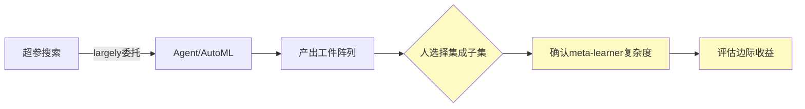

# 第21章 调优与集成：Agent 搜索，人选择

> **本章目标**：把“调参”和“集成”这两件最容易被自动化的事，讲清楚人机分工。超参搜索可以 largely 交给 Agent/AutoML，但**集成子集的选择、meta-learner 的复杂度、收益的边际递减**，这些判断必须人来下。

---

## 开篇：调参是体力活，选择是脑力活

调参和集成，是 Kaggle 里最容易被“自动化焦虑”笼罩的两件事。很多人担心：AutoML 这么强，调参还要人干嘛？集成这么复杂，Agent 一键搞定，还要人干嘛？

答案是：**调参是体力活，可以交给 Agent；选择是脑力活，必须人来做。**

Agent 能帮你把 1000 组超参跑完，但它不知道“哪组参数背后的模型更值得进集成”。Agent 能帮你把 50 个模型加权平均，但它不知道“这 50 个里哪 5 个是真正互补的”。这些“选择”，依赖你对 OOF 质量、多样性、复杂度的判断。



---

## 21.1 超参数搜索 largely 委托给 Agent/AutoML

人设定搜索空间和计算预算；Agent 执行并产出工件。

超参搜索是最适合委托的活：目标明确（CV 分数）、可枚举（参数网格）、可并行（多组同时跑）。人只需要定两件事：
- **搜索空间**：哪些参数、什么范围（比如 `learning_rate ∈ [0.01, 0.1]`）；
- **计算预算**：最多跑多少组、每组多久。

剩下的交给 Agent。它跑完 1000 组，产出 1000 个工件，按 CV 排序给你看。

```python
# src/tuning/search_space.py
"""
超参搜索空间定义：人定，Agent 执行。
"""
SEARCH_SPACE = {
    "lgbm": {
        "learning_rate": [0.01, 0.05, 0.1],
        "num_leaves": [31, 63, 127],
        "min_child_samples": [20, 50],
    },
    "xgb": {
        "max_depth": [4, 6, 8],
        "eta": [0.01, 0.05, 0.1],
        "subsample": [0.8, 1.0],
    },
}


def estimate_trials(space):
    """估算总试验数，人据此定预算。"""
    n = 1
    for v in space.values():
        n *= len(v)
    return n
```

---

## 21.2 集成的“选择”不是搜索问题

哪些模型进入集成、用什么 meta-learner、权重是否稳定，需要人查看 OOF 工件的质量和相关性结构。NVIDIA 的冠军方案从 850 个模型中选出 150 个做四级 stacking，**选择过程**包含人对 OOF 质量和多样性的判断。

为什么集成选择不能纯自动化？因为“互补性”是个**语义判断**，不是数值优化能完全覆盖的。两个模型 CV 差不多、相关性也不高，但一个是树模型、一个是神经网络——它们大概率互补；两个都是 XGBoost 不同超参，相关性可能 0.99，堆一起没用。这种“家族层面的判断”，Agent 做不了。

```python
# src/ensembles/diversity_check.py
"""
多样性检查：相关性矩阵 + 家族标签。
人看这个表决定谁进集成。
"""
import numpy as np
import pandas as pd


def diversity_report(oofs, family_map):
    """
    oofs: {模型名: OOF数组}
    family_map: {模型名: 家族标签，如 'gbm'/'nn'/'linear'}
    返回相关性矩阵 + 家族分布，供人判断。
    """
    names = list(oofs)
    M = np.column_stack([oofs[n] for n in names])
    corr = pd.DataFrame(np.corrcoef(M, rowvar=False), index=names, columns=names)
    fams = pd.Series(family_map)
    print("家族分布：", fams.value_counts().to_dict())
    print("高相关对（>0.98）：")
    for i in range(len(names)):
        for j in range(i + 1, len(names)):
            if corr.iloc[i, j] > 0.98:
                print(f"  {names[i]} ~ {names[j]}: {corr.iloc[i, j]:.3f}")
    return corr
```

---

## 21.3 AutoGluon 的多层 stacking vs 人工定制的 stacking

AutoGluon 的 stacking 是自动化的强基线；人工 stack 的价值在于引入 AutoGluon 之外的模型家族。

AutoGluon 内部已经做了多层 stacking，但只在它自己的模型家族里。人工 stack 的价值是“引入外援”——TabPFN、神经网络、XGBoost，增加多样性。这就像 AutoGluon 给你炒了一桌川菜，你人工 stack 是加一道粤菜——口味越杂，覆盖越广。

---

## 21.4 Agent 驱动的集成实验管理

工件规范让 Agent 可以自动做 hill climbing 的候选生成；人审核最终集成的 CV 稳定性和复杂度代价。

Agent 可以快速生成“候选集成方案”（比如 100 种不同的子集组合），但人要从里面挑出“CV 稳定 + 复杂度可接受”的那个。判断标准：
- bootstrap 下 CV 稳定吗？
- 子集里有没有冗余（相关性 > 0.98）？
- 复杂度增加是否带来成比例收益？

---

## 21.5 集成收益的边际递减与过拟合风险


集成不是越多越好。从 1 个到 3 个，收益明显；从 10 个到 50 个，收益递减，过拟合风险上升。**人判断“够了”的能力，比“堆更多”的能力更值钱。**

---

## 21.6 小结

- 超参搜索 largely 委托 Agent/AutoML，人定搜索空间和预算；
- 集成子集的选择是语义判断，不是数值优化；
- AutoGluon stacking 是强基线，人工 stack 引入外援；
- Agent 生成候选，人审核稳定性与复杂度；
- 集成收益边际递减，人判断“够了”。

一句话：**Agent 帮你“搜”，人帮你“选”。** 搜索可以自动化，选择不能。

举个具体场景。你让 Agent 跑完超参搜索，它给你一份报告：

```
请在固定 CV 下跑完 configs 里的 12 组 LightGBM 参数，
按 CV 降序列出，并标出 OOF 相关性矩阵里高度相关的组。
不要自动挑"最好的"去做集成，我要自己看。
```

模型会这样汇报：

```
> （思考过程）用户明确要"列出来但不要替我选"。我按 CV 降序
> 排，标注相关性高的组（同族超参变体），并给出我的观察，
> 但强调"选哪几个进集成由你定"。

【12 组结果（CV 降序，AUC）】
  v003  0.8712  ← num_leaves=63,  lr=0.05
  v007  0.8709  ← num_leaves=63,  lr=0.03
  v001  0.8705  ← num_leaves=31,  lr=0.05
  v010  0.8698  ← num_leaves=127, lr=0.05
  ...
【高相关组（>0.98，属于同族变体）】
  v003 ~ v007 : 0.993   （只差学习率）
  v001 ~ v005 : 0.987
  v010 ~ v011 : 0.991

【我的观察】
  前 4 名里有 3 个属于"num_leaves=63"这一族，
  它们相关性极高，一起进集成意义不大（等于同一个模型投三票）。
  如果你要多样性，建议从 v003（63/0.05）、v001（31/0.05）、
  v010（127/0.05）里各留一个——它们叶子数不同，偏差结构不同。
  但这是我的建议，最终留哪些请你确认。

没有生成任何集成工件，等你决定。
```

它把“哪些是冗余的”“为什么冗余”“建议怎么留”都说清楚了，但**最后一句明确“没有生成任何集成工件”**。这就是第 2 章那份 `agent_policy.yaml` 在真实对话里的体现。

> **下一章预告**：第 22 章 VibeKaggle 的策略与心态。选比赛、提交预算、团队协作、从“我会做 Kaggle”到“我会指挥系统做 Kaggle”。