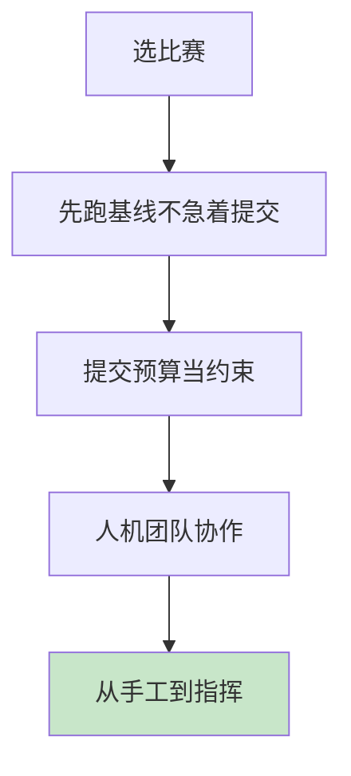

# 第22章 VibeKaggle 的策略与心态

> **本章目标**：前面二十一章都是“术”，这一章讲“道”。选了比赛、跑了基线、调了模型、做了集成，但真正决定你能走多远的，是策略和心态：怎么选比赛、怎么管提交预算、怎么和 Agent 队友协作、怎么从“我会做 Kaggle”变成“我会指挥系统做 Kaggle”。

---

## 开篇：技术之外，还有一层“决策”

你有没有见过这种人：代码写得贼溜，模型调得贼精，但每次比赛都卡在中游，上不去。

为什么？不是技术问题，是**策略问题**。他可能：
- 选了一场比赛，做到一半发现数据有坑、时间不够；
- 提交额用得太随意，关键时候没额度了；
- 一个人闷头干，不知道讨论区早有人分享了关键 insight；
- 沉迷优化，从没退一步想“我现在该往哪使劲”。

VibeKaggle 用 Agent 放大了你的“执行力”，但执行力再强，方向错了也是白跑。所以这一章讲的就是这些“方向性”的东西。



---

## 22.1 选择比赛的标准

前面第 1.2 节讲过怎么选入门比赛，这里补充一个 Agent 时代的新维度：**自动化工具在该模态上的成熟度。**

| 模态 | 自动化成熟度 | Agent 杠杆 | 适合谁 |
|------|-------------|-----------|--------|
| 表格 | 高（AutoGluon 能打） | 高 | 新手首选，Agent 帮最多 |
| 时序 | 中（AutoGluon-TS 可用） | 中 | 学时间纪律，Agent 有边界 |
| 图像 | 中（DINOv3 微调成熟） | 中 | 学数据清洗，人要盯 |
| 文本 | 高（LLM 原生） | 高 | 但要防 LLM 幻觉 |

新手建议：**先从表格开始，Agent 的杠杆最高，你能最快看到“人机协作”的甜头。** 等熟练了，再挑战时序/图像/文本。

---

## 22.2 先让 Agent 跑自动基线，但不要在第一小时就提交

先看 CV 和工件质量，再决定是否消耗提交预算。

新手最容易犯的错：跑完第一个基线，激动地马上提交，看到一个不好不坏的分数，然后就不知道该干嘛了。正确姿势是：**先跑基线，看 CV，看工件，想清楚方向，再提交。**

而且，第一版基线往往有 bug（格式错、泄漏、预处理错），急着提交可能浪费额度在一个废品上。

---

## 22.3 提交预算作为工作流的内置约束

Agent 让提交“零摩擦”，但零摩擦是风险。人必须保留**提交决策权和预算控制权**。

这一点全书反复强调，这里给出一个实操的“提交决策清单”，每次提交前过一遍：

```python
# src/utils/submit_decision.py
"""
提交决策清单：每次消耗提交额度前，人过一遍。
"""
SUBMIT_CHECKLIST = [
    "本地 CV 有提升吗？提升超过噪声吗？",
    "多个模型/多种子结果一致吗？（还是只在某一个 seed 好？）",
    "OOF 质量检查过了吗？（分布、校准、泄漏）",
    "这次提交的信息量够吗？（能学到新东西还是重复已知？）",
    "今天提交额度还剩几次？值不值得花？",
]


def review_before_submit():
    print("提交前决策清单：")
    for i, item in enumerate(SUBMIT_CHECKLIST, 1):
        print(f"  [{i}] {item}")
    print("任何一条不确定，就别交。")


if __name__ == "__main__":
    review_before_submit()
```

关键心态：**每一次提交都是一次“信息购买”**。你花一次额度，换回一个 LB 分数信息。如果这次提交学不到新东西（比如和上次几乎一样），那就是浪费。

---

## 22.4 团队协作的新形态：人类队友 + Agent 队友

人负责方向和验证，Agent 负责实验吞吐和工件生产。

过去的 Kaggle 团队，是“人和人”组队。现在多了“Agent 队友”。新的团队形态是：
- **人类队友**：定方向、做验证、拍板提交、负责领域判断；
- **Agent 队友**：写代码、跑实验、管工件、做初筛。

这带来一个新问题：**怎么“管理” Agent 队友？** 答案是 Harness——第 2 章讲的验证协议、工件规范、预算策略，本质上就是“给 Agent 队友立的规矩”。规矩立得好，Agent 队友就是最佳员工；立不好，它就是个捣蛋鬼。

---

## 22.5 从“我会做 Kaggle”到“我会指挥系统做 Kaggle”

竞赛履历的价值正在从手工能力转向**工作流设计能力和判断质量**。

这句话值得反复品。过去，Kaggle 高手 = 会写代码、会调参、会做特征。现在，这些能力 Agent 都能帮你，那你的价值在哪？

价值转移到了：
- **设计工作流**：能不能给 Agent 搭一套高效的 Harness？
- **判断质量**：能不能在关键时刻做出对的决策（选指标、定验证、挑集成、管预算）？
- **领域洞察**：能不能发现 Agent 发现不了的数据问题（纸板噪声、时间泄漏、语义偏差）？

这就是从“运动员”到“教练”的转变。教练不亲自上场，但他决定战术、选人、临场调整——这些才是赢球的关键。

---

## 22.6 小结

- 选比赛看“自动化成熟度”，表格最适合起步；
- 先跑基线不急着提交，看 CV 和工件；
- 提交预算当约束，每次提交都是“信息购买”；
- 团队是“人类队友 + Agent 队友”，靠 Harness 管理；
- 价值从“手工能力”转向“工作流设计 + 判断质量”。

这一章没有代码、没有模型，但它可能是全书最“值钱”的一章。因为技术会被自动化，但**判断力不会**。

> **下一章预告**：第 23 章从 VibeKaggle 到实际项目。竞赛里的工件规范、验证纪律、提交控制，在生产 ML 流水线里同样是核心问题。这一章讲怎么把比赛经验迁移到真实工作。