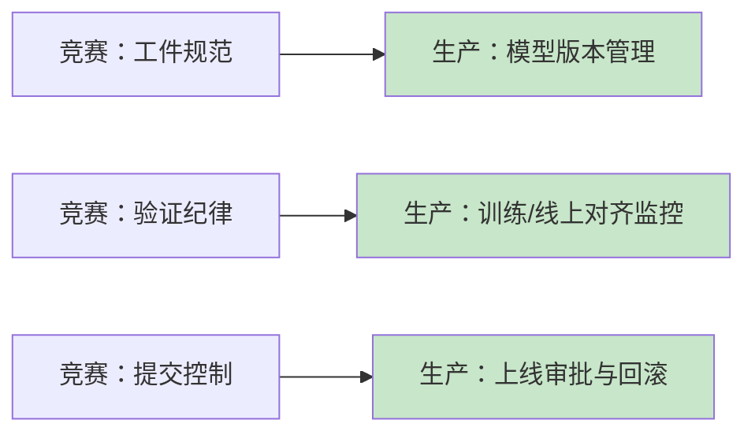

# 第23章 从 VibeKaggle 到实际项目

> **本章目标**：把竞赛里的经验迁移到真实工作。工件规范、验证纪律和提交控制，在生产 ML 流水线里同样是核心问题。本章讲怎么把 Agent 辅助的竞赛代码变成可维护项目，怎么搭一个最小的生产预测接口，以及继续学习的资源。

---

## 开篇：比赛是练兵场，不是战场

竞赛和生产项目最大的区别是什么？有人说是“数据干净不干净”，有人说是“评分机制有没有”。我觉得最大的区别是**“后果”**。

竞赛里，模型错了，你掉几个名次；生产里，模型错了，可能导致用户误贷、医疗误诊、交易损失。所以竞赛里可以允许的“快进猛出”，在生产里必须先经过审查。

但**“工件规范、验证纪律、提交控制”**这三件事，在竞赛里是核心，在生产里更是核心。生产环境下，你不需要排行榜，但你同样需要：
- 每个模型版本产出可复现的预测工件；
- 验证方案固定，不能随意换；
- 上线前必须有人签字确认。

所以 VibeKaggle 不是教你“只能打比赛”，它教的是一套**可迁移的 ML 工程纪律**。



---

## 23.1 VibeKaggle 工作流与生产 ML 流水线的异同

| 维度 | Kaggle 竞赛 | 生产 ML 项目 |
|------|------------|-------------|
| 工件规范 | OOF/test_preds 工件 | 模型版本、特征快照、预测日志 |
| 验证纪律 | 固定 CV 折 | 训练集/线上集分布一致性监控 |
| 提交控制 | 每日提交预算 | 上线审批、回滚机制、灰度发布 |
| Agent 角色 | 跑实验、管工件 | 生成训练脚本、做特征初探、写测试用例 |
| 人的角色 | 定验证、拍板提交 | 定业务目标、做风险评估、审核上线 |

对比一看，差异不大，只是场景换了。竞赛练的“固定验证协议”，在生产里就是“建模和线上必须用同一套切分逻辑，否则监控报警无意义”；竞赛练的“提交前断言”，在生产里就是“上线前必须通过格式/范围/非负断言”。

---

## 23.2 把 Agent 辅助的竞赛代码变成可维护项目

竞赛代码通常是“一次性脚本”，跑完就扔。要变成可维护项目，需要补四样东西：

| 竞赛一次性 | 生产可维护 | 做什么 |
|------------|------------|--------|
| 脚本到处都是 | 模块化代码 | `src/` 下按职责分模块（features/models/ensembles） |
| 乱写日志 | 实验日志系统 | JSON Lines + 元数据 Schema，可追溯 |
| 硬编码路径 | 配置管理 | YAML 配置 + 环境变量，不硬编码 |
| 跑就完了 | 可复现性检查 | 锁依赖版本、记录随机种子、保存工件哈希 |

下面是一个**最小可维护项目结构**示例：

```
project/
├── src/
│   ├── __init__.py
│   ├── features/       # 特征工程（可复用）
│   ├── models/         # 模型定义与训练
│   ├── ensembles/      # 集成逻辑
│   └── utils/          # 工具（自检、CV协议、日志）
├── configs/
│   ├── cv_protocol.yaml    # 验证协议（不可变）
│   ├── agent_policy.yaml   # Agent 权限策略
│   └── model_config.yaml   # 模型超参
├── artifacts/            # 工件（Git 忽略，用 DVC/MLflow 管理）
├── tests/                # 单元测试（验证格式、防泄漏）
├── requirements.txt      # 锁依赖版本
└── README.md             # 复现说明
```

关键变化：加了 `tests/`。竞赛里可能不写测试，但生产项目必须有——验证“特征没有泄漏”“工件格式合规”“CV 折索引哈希一致”，都可以写成自动化测试，每次提交前跑一遍。

---

## 23.3 模型部署基础（精简保留）

部署一个预测服务，最小可行的是一个 FastAPI 接口：输入特征，返回预测值。下面是一个可直接跑的简例：

```python
# src/api/predict_api.py
"""
FastAPI 预测接口简例：最小可行的模型服务。
生产环境还需加鉴权、限流、监控、灰度，这里只展示核心骨架。
"""
from fastapi import FastAPI
from pydantic import BaseModel
import numpy as np
import joblib

app = FastAPI(title="VibeKaggle Predict API")


class PredictRequest(BaseModel):
    features: dict   # 特征字典，按训练时的列名


class PredictResponse(BaseModel):
    prediction: float
    model_version: str


# 模型在启动时加载一次（生产环境建议加版本管理和热重载）
MODEL = joblib.load("artifacts/models/latest.pkl")
MODEL_VERSION = "v001"


@app.post("/predict", response_model=PredictResponse)
def predict(req: PredictRequest):
    """接收特征，返回预测。生产环境需加输入校验与断言。"""
    X = np.array([list(req.features.values())]).reshape(1, -1)
    pred = float(MODEL.predict(X)[0])
    return PredictResponse(prediction=pred, model_version=MODEL_VERSION)


if __name__ == "__main__":
    import uvicorn
    uvicorn.run(app, host="0.0.0.0", port=8000)
```

部署时，记得加上第 4 章那种“提交前断言”式的**输入校验**（特征范围、缺失值、类别合法性），这是生产里最容易出事的地方。

---

## 23.4 继续学习的资源

竞赛结束后，想继续深入，可以看这些：

| 方向 | 资源 | 适用 |
|------|------|------|
| Agent 辅助竞赛 | MLE-Bench | 理解 Agent 在 ML 任务上的能力边界 |
| Agentic 工作流 | Agentic Kaggle Skill | 如何把 Agent 接入 Kaggle 平台 |
| 工作流设计 | Kaggle 社区中 Agent 辅助的 writeup | 学习别人怎么设计 Harness |
| 生产 ML | MLOps 相关课程/书籍 | 从竞赛代码到生产流水线 |
| 表格 AutoML | AutoGluon 官方文档 | 深入了解基线框架 |

---

## 23.5 全书知识点回顾

读到这里，建议你把全书的核心心法捋一遍，作为“随时查”的速查表：

1. **工件规范是物理基础**：没有工件，Agent 的高吞吐只会制造混乱；
2. **验证优先是不可让渡的判断**：验证方案人设、Agent 执行，折索引哈希防篡改；
3. **Agent 执行和枚举，人负责判断**：选指标、定验证、挑集成、管预算，都得人来；
4. **提交预算是护栏**：零摩擦是风险，预览-确认机制是必须的；
5. **时间纪律不可委托**：时序问题里，随机切分默认拒绝；
6. **领域合理性是第二道守门**：分数好不等于物理/临床可信；
7. **从运动员到教练**：你的价值不在写代码，在设计工作流和做判断。

把这七条背下来，无论打什么比赛、做什么项目，都不会跑偏。

---

> **本书到此结束。** 祝你在 Kaggle 赛场和实际项目里，都能把 Agent 当成最得力的队友，而不是盲目跟随的工具。记住：指挥系统，比写代码更值钱。